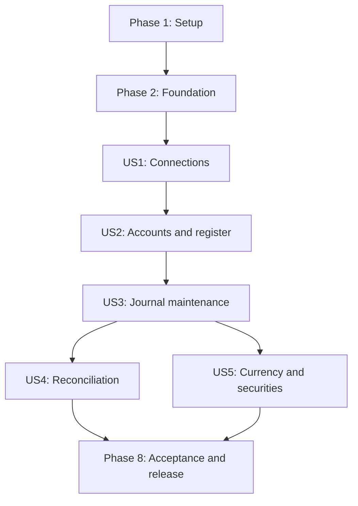

# Tasks: SQL Desktop Foundation

**Input:** [spec.md](spec.md), [plan.md](plan.md), [research.md](research.md),
[data-model.md](data-model.md), [application services](contracts/application-services.md),
[desktop UI](contracts/desktop-ui.md), and [quickstart.md](quickstart.md).

**Organization:** Shared setup, shared foundation, five user stories, then release validation.
Each checkbox is one implementation task. IDs remain stable once work starts.

**Tests:** The spec calls for automated write checks and acceptance evidence. Constitution III
also requires business-rule and SQL boundary tests. Write the listed tests before the related
implementation. Confirm they fail for the missing behavior, then make them pass. A test project
that cannot build is not evidence of a failing behavioral test.

**Format:** `- [ ] Tnnn [P] [USn] Description with file paths`. `[P]` marks work that can run
beside the explicitly named tasks in the parallel examples. It does not bypass prerequisites.
All paths are relative to the repository root. Referenced source files are planned outputs.

**Scope:** Follow research decisions D-001–D-008. Put all procedure calls in
`StoredProcedureRepository`. Use EF for metadata and line reconciliation. Use one hardcoded
expected schema version and one stored integer. Journal controls cover stale-version detection
and atomic writes under FR-017.
Securities remain required by US5. Add no safeguards without a requirement or concrete current risk.

## Phase 1: Setup

**Purpose:** Establish the .NET 10 projects, required tools, and Windows build checks.

- [ ] T001 Create `FatStacks.slnx`, `src/FatStacks.Core/FatStacks.Core.csproj`, `src/FatStacks.Infrastructure/FatStacks.Infrastructure.csproj`, and `src/FatStacks.Desktop/FatStacks.Desktop.csproj`. Target Core/Infrastructure at `net10.0` and WPF at `net10.0-windows`. Keep references consistent with the three boundaries in D-001.

- [ ] T002 Pin a supported .NET 10 SDK patch in `global.json`. Enable nullable references and repository analyzer settings in `Directory.Build.props` and `.editorconfig`. Select the Microsoft.Testing.Platform runner used by quickstart commands.

- [ ] T003 Pin EF Core 10 SQL Server, SqlClient, Autofac, grate, and MSTest versions in the project files and `.config/dotnet-tools.json`. Record purpose, license, transitive footprint, support, and security findings in `docs/dependencies.md` before adoption (D-008).

- [ ] T004 Create `tests/FatStacks.Tests/FatStacks.Tests.csproj`, `tests/FatStacks.SqlTests/FatStacks.SqlTests.csproj`, and `tests/FatStacks.WindowsChecks/FatStacks.WindowsChecks.csproj`. Configure MSTest and platform UI Automation references without adding a wrapper framework.

- [ ] T005 [P] Copy the required WPF resources, icons, and Fluent license from `.workspace/dotnet-beancount/src/BeancountViewer/` into `src/FatStacks.Desktop/Assets/` and `src/FatStacks.Desktop/App.xaml`. Retain the baseline styles and remove file-parser dependencies.

- [ ] T006 [P] Add a Windows restore/build/analyzer/service-test job in `.github/workflows/ci.yml`. Add a SQL Server test job using isolated test credentials, and document the interactive-session requirement for UI tests in `docs/testing.md`. Missing SQL/UI prerequisites must remain visible.

- [ ] T007 [P] Document Windows 11 x64, SQL Server 2022+, .NET desktop workload/runtime, restore/build/test/run commands, and external credential setup in `README.md` (Principle II; D-008).

**Checkpoint:** The empty solution restores, builds, and runs its test harnesses on compatible runners.

## Phase 2: Foundation

**Purpose:** Provide shared storage and platform boundaries before user-story work.
The schema tasks reproduce field constraints from the data model verbatim. They also require
single-column keys, bigint identity defaults except singleton rows, tinyint catalogs, date-only
accounting dates, and UTC `CreateDate`/`UpdateDate` columns.

- [ ] T008 Create the grate package layout in `database/README.md`, `database/up/`, `database/tables/`, `database/sprocs/`, `database/views/`, and `database/types/`. Execute one-time table migrations, not review-only current table definitions. Keep applied scripts immutable. Configure `text -merge` for procedure/view definitions in `.gitattributes`. Add `database/permissions/RuntimeRole.sql` for a non-administrator runtime role with required table DML and procedure EXECUTE rights, but no DDL. Apply it explicitly with maintenance privileges after schema deployment. Do not use EF migrations or schema creation (FR-028/033; D-006).

- [ ] T009 Create catalogs, Book, and SchemaVersion in `database/up/001_CreateBookAndCatalogs.sql` with current definitions in `database/tables/`.

  Catalog constraints:
  “AccountClass | AccountClassId tinyint PK; unique Name; five rows: Assets, Liabilities, Equity, Income, Expenses”;
  “DisplayGroup | DisplayGroupId tinyint PK; unique Name; Banks, Credit Cards, Investments, Expenses, Other”;
  “AccountType | AccountTypeId tinyint PK; unique Name; AccountClassId FK; DefaultDisplayGroupId FK”;
  “Currency | CurrencyId tinyint PK; unique Code char(3); Name; FractionalDigits tinyint”;
  “Bank | Assets | Banks”;
  “Cash | Assets | Banks”;
  “Credit Card | Liabilities | Credit Cards”;
  “Loan Receivable | Assets | Other”;
  “Loan Payable | Liabilities | Other”;
  “Investment/Brokerage | Assets | Investments”;
  “Other Asset | Assets | Other”;
  “Other Liability | Liabilities | Other”;
  “Equity | Equity | Other”;
  “Income | Income | Other”;
  “Expense | Expenses | Expenses”.

  Book constraints:
  “BookId | bigint PK, assigned 1 without IDENTITY; CHECK BookId = 1 permits only one book”;
  “StableIdentifier | uniqueidentifier, NOT NULL, UNIQUE; permanent logical identity”;
  “Name | nvarchar(200), required”;
  “CurrencyId | tinyint FK, required; defaults to USD during setup”;
  “TimeZoneId | nvarchar(100), required; valid Windows TimeZoneInfo ID”;
  “CurrencyLocked | bit, default 0; becomes 1 with the first saved journal entry”;
  “CreateDate, UpdateDate | UTC datetime2(7)”.

  SchemaVersion constraints:
  “SchemaVersion has SchemaVersionId bigint PK, assigned 1 without IDENTITY, with CHECK value = 1.”;
  “Its Version is int NOT NULL.” Seed the five classes, five stored groups, eleven type mappings, USD (2), EUR (2), and JPY (0). Publish schema version 1 only at successful package completion; never seed a user Book in SQL. CurrencyLocked remains true after entries are deleted (FR-007/020/024/032).

- [ ] T010 Create Account in `database/up/002_CreateAccounts.sql` and `database/tables/Account.sql`.

  Field constraints:
  “AccountId | bigint PK”;
  “BookId | bigint FK”;
  “ParentAccountId | nullable bigint FK to Account”;
  “Name | nvarchar(200), trimmed and nonempty”;
  “AccountTypeId | tinyint FK; fixed after creation in phase 1”;
  “DisplayGroupId | tinyint FK; defaults from type, may be changed”;
  “OpenDate, CloseDate | date; CloseDate nullable”;
  “CreateDate, UpdateDate | UTC datetime2(7)”. Preserve “UNIQUE(BookId, ParentAccountId, Name)” under a case-insensitive collation;
  “CHECK ParentAccountId differs from AccountId.”;
  “CHECK CloseDate is null or later than OpenDate.” Keep foreign keys restrictive (FR-008).

- [ ] T011 Create journal tables in `database/up/003_CreateJournal.sql`, `database/tables/JournalEntry.sql`, and `database/tables/JournalEntryLine.sql`.

  Header constraints:
  “JournalEntryId | bigint PK; stable identity and equal-date ordering key”;
  “BookId | bigint FK”;
  “AccountingDate | date, required”;
  “BankPostingDate | nullable date, independent of AccountingDate”;
  “Payee | nvarchar(200), optional”;
  “Description | nvarchar(1000), required; may be empty”;
  “EntryKind | tinyint: 0 ordinary, 1 security opening, 2 security transfer”;
  “Version | rowversion”;
  “CreateDate, UpdateDate | UTC datetime2(7)”.

  Line constraints:
  “JournalEntryLineId | bigint PK; preserved on edits”;
  “JournalEntryId | bigint FK”;
  “AccountId | bigint FK”;
  “LineOrder | int, positive; UNIQUE(JournalEntryId, LineOrder)”;
  “Debit, Credit | decimal(10,2), NOT NULL”;
  “ReconciliationStatus | tinyint, NOT NULL, default 0; CHECK value in (0,1,2)”;
  “SecurityId | nullable bigint FK”;
  “Quantity | nullable decimal(18,8), signed movement”;
  “Version | rowversion”;
  “CreateDate, UpdateDate | UTC datetime2(7)”. Enforce “CHECK requires Debit > 0 and Credit = 0, or Credit > 0 and Debit = 0.” Preserve independent rowversions and restrictive foreign keys. Add the three indexes named in data-model.md; the security FK follows the next migration (FR-014/017/019/021).

- [ ] T012 Create Security and finish security-line constraints in `database/up/004_CreateSecurities.sql` and `database/tables/Security.sql`.

  Fields:
  “SecurityId | bigint PK”;
  “BookId | bigint FK”;
  “Symbol | nvarchar(32), required; UNIQUE(BookId, Symbol)”;
  “Name | nvarchar(200), required”;
  “QuantityPrecision | tinyint, CHECK 0 through 8”;
  “CreateDate, UpdateDate | UTC datetime2(7)”. Enforce “CHECK requires SecurityId and Quantity together, with nonzero Quantity.” Positive quantity accompanies a debit; negative quantity accompanies a credit. Update the current JournalEntryLine definition to match. Use the schema-version publication step in `database/up/005_SetSchemaVersion.sql` (FR-025).

- [ ] T013 Implement mapped entities, explicit SQL types/lengths, relationships, and rowversion concurrency tokens in `src/FatStacks.Infrastructure/Persistence/BookDbContext.cs` and `src/FatStacks.Infrastructure/Persistence/Entities/`. Match the preceding schema tasks exactly; use assigned singleton keys and one context per operation. Add sanitized failure-category mapping in `src/FatStacks.Infrastructure/Diagnostics/DatabaseErrors.cs`. Disable sensitive-data and private SQL parameter logging (FR-028/029).

- [ ] T014 Define UI-independent typed outcomes and operation contracts in `src/FatStacks.Core/Contracts/`. Add operation-scoped context/connection creation in `src/FatStacks.Infrastructure/Persistence/BookDatabase.cs` and the sole procedure-call class in `src/FatStacks.Infrastructure/Persistence/StoredProcedureRepository.cs`. Limit it to typed parameter binding, execution, and result mapping; keep workflows in services (D-001/002).

- [ ] T015 Create isolated grate-deployed SQL fixtures in `tests/FatStacks.SqlTests/Fixtures/BookDatabaseFixture.cs` and Windows launch helpers in `tests/FatStacks.WindowsChecks/Fixtures/DesktopFixture.cs`. Separate synthetic fixtures from production configuration. Verify required constraints and runtime DDL denial in `tests/FatStacks.SqlTests/SchemaTests.cs`; record actual test outcomes.

**Checkpoint:** Grate creates an empty compatible schema. EF maps it without creating it.
SQL constraints and the test fixtures work on SQL Server. No story begins before this foundation passes.

## Phase 3: US1 — Connect to the Right Book (P1)

**Goal:** Initialize explicitly, save named profiles, and open one identified book at a time.

**Independent test:** Initialize two empty databases, open/switch/restart, then try an unreachable
profile, wrong Book identity, and mismatched schema version. Expect no leaked records, automatic
schema changes, or fallback connection. The connection dialog remains available after failure.

### Tests

- [ ] T016 [P] [US1] Write profile tests in `tests/FatStacks.Tests/Profiles/ProfileTests.cs`: stable GUIDs, case-insensitive unique nonempty names, rename/remove, corrupt configuration, unavailable credential protection, atomic replacement failure, and last-successful-profile behavior (FR-001/002/003/006).

- [ ] T017 [P] [US1] Write real SQL connection/setup tests in `tests/FatStacks.SqlTests/Connections/ConnectionTests.cs`: empty/repeated/unrelated/interrupted setup, separate maintenance privileges, stored-version equality, missing/unreadable/mismatched version, distinct Book IDs, and explicit reassociation (FR-005/028/032).

- [ ] T018 [P] [US1] Write session tests in `tests/FatStacks.Tests/Connections/SessionTests.cs` and transport cases in `tests/FatStacks.SqlTests/Connections/TransportTests.cs`. Cover delayed reads, write-target capture, switch cancellation/failure, startup cancellation, valid/no TLS, self-signed/expired certificates, and authentication failure (FR-003/004/030).

### Implementation

- [ ] T019 [US1] Implement local profile records and storage in `src/FatStacks.Infrastructure/Configuration/ProfileStore.cs` and `src/FatStacks.Core/Connections/ConnectionProfile.cs`. Preserve “ProfileId GUID”, “unique case-insensitive FriendlyName”, and “ExpectedBookIdentifier GUID” as optional. Store “FormatVersion, Profiles, and LastSuccessfulProfileId” under current-user local application data. Protect secret content with Windows current-user DPAPI and replace settings atomically (FR-001/002/006).

- [ ] T020 [US1] Implement EF book setup and explicit grate maintenance in `src/FatStacks.Infrastructure/Connections/DatabaseSetup.cs`. Collect name, currency, and valid Windows time zone; default USD. Use separate transient maintenance credentials. Reject unrelated/incompatible databases and preserve an existing compatible Book on repeated setup. Permit explicit completion when a compatible schema lacks its Book (FR-005/028).

- [ ] T021 [US1] Implement `src/FatStacks.Infrastructure/Connections/ConnectionService.cs` and `src/FatStacks.Core/Connections/SchemaCompatibility.cs`. Hardcode expected schema version 1 and compare the stored integer before activation. Fatal version errors leave no active session. Verify expected logical Book identity and require explicit reassociation on mismatch. Keep Test separate from activation (FR-005/032; D-006).

- [ ] T022 [US1] Implement SqlClient transport settings and warning results in `src/FatStacks.Infrastructure/Connections/SqlTransport.cs`. Use TLS when available; permit usable plaintext and self-signed/expired-certificate connections with visible non-blocking condition warnings. Preserve authentication/protocol failures; never log secrets (FR-029/030; D-007).

- [ ] T023 [US1] Implement `src/FatStacks.Core/Connections/BookSessionCoordinator.cs`: capture connection/book identity per operation, resolve unsaved edits and running writes before switching, cancel old reads, reject old-session results, clear prior UI data, and leave failed switches disconnected. Support save/discard/cancel callbacks without WPF types (FR-003/004).

- [ ] T024 [US1] Configure Autofac property injection in `src/FatStacks.Desktop/App.xaml.cs`. Resolve only at composition boundaries, supply required properties before use, own a child scope per active book, and dispose operation contexts and obsolete session resources. Keep WPF updates on the dispatcher (Principles I/V; D-001).

- [ ] T025 [US1] Build `src/FatStacks.Desktop/Views/ConnectionWindow.xaml`, `src/FatStacks.Desktop/ViewModels/ConnectionViewModel.cs`, and `src/FatStacks.Desktop/Views/BookSetupWindow.xaml`. Provide profile CRUD, integrated/SQL authentication, Test/Open/Initialize, explicit reassociation, progress/cancel, and non-blocking transport warnings. Show active profile and Book identity in `src/FatStacks.Desktop/MainWindow.xaml` (FR-001–006/030/032).

- [ ] T026 [US1] Wire last-successful-profile startup and cancellation in `src/FatStacks.Desktop/ViewModels/StartupViewModel.cs`. Test and failed switches must not replace the remembered ID. Report preference failures independently from a usable connection or committed accounting operation (FR-003/006).

- [ ] T027 [US1] Automate connect/switch/restart/reassociate in `tests/FatStacks.WindowsChecks/ConnectionJourneyTests.cs`. Execute the US1 tests and record SQL/Windows evidence separately in `specs/001-sql-desktop-foundation/validation/us1.md`. Keep unavailable-runner checks marked unverified (SC-001/006).

**Checkpoint:** US1 is a working connection/setup increment. It does not yet provide journal entry editing.

## Phase 4: US2 — Set Up Accounts and Browse the Familiar Register (P1)

**Goal:** Create hierarchical accounts and browse the retained account tree, tabs, register,
search, and details without losing full-history balances.

**Independent test:** Use a synthetic SQL fixture with all five classes, nested/closed accounts,
old openings, equal-date entries, and split lines. Account setup works without journal-editor UI.
Fixture seeding is test-only and does not depend on the US3 procedure implementation.

### Tests

- [ ] T028 [P] [US2] Write account/type/calendar tests in `tests/FatStacks.Tests/Accounts/AccountTests.cs` and `tests/FatStacks.Tests/Calendar/BookCalendarTests.cs`. Cover all eleven type mappings, group overrides, stable rename identity, cycles, closure boundaries, daylight-saving transitions, and device-zone independence (FR-007/008/019/024).

- [ ] T029 [P] [US2] Write SQL register reference tests in `tests/FatStacks.SqlTests/Register/RegisterTests.cs`. Seed balanced synthetic records directly in a test transaction. Cover older opening balances, description/counter-account case-insensitive search, literal search metacharacters, equal dates, zero-net rows, split details, closed descendants, and aggregate values beyond one-line range (FR-009–012).

### Implementation

- [ ] T030 [US2] Implement EF account operations in `src/FatStacks.Infrastructure/Accounts/AccountService.cs` and requests in `src/FatStacks.Core/Accounts/AccountRequests.cs`. Preserve “nvarchar(200), trimmed and nonempty”; disallow colon separators, duplicate siblings, ancestor cycles, and cross-book parents. Keep type fixed, permit group overrides, retain closed history, and reject closure dates invalidating existing lines. Historical edits may keep existing closed references only before closure (FR-007/008).

- [ ] T031 [US2] Implement the book calendar and testable clock boundary in `src/FatStacks.Core/Calendar/BookCalendar.cs`. Supply book-local today and the inclusive today-minus-89-days cutoff; keep accounting/bank dates as DateOnly and operational timestamps UTC (FR-019).

- [ ] T032 [US2] Implement `database/sprocs/ReadAccountRegister.sql`. Net selected-account lines per entry, calculate full-history running balances before date/search filters, and order by AccountingDate/JournalEntryId. Preserve zero-net rows and return decimal(28,2) monetary aggregates. Keep one current definition (FR-010/011/033; D-004).

- [ ] T033 [US2] Add the register procedure call to `src/FatStacks.Infrastructure/Persistence/StoredProcedureRepository.cs`. Implement EF batch balance and detail reads in `src/FatStacks.Infrastructure/Register/RegisterService.cs`. Include every line, closed-account links, and descendant contributions. Map positive net credits to Payment and net debits to Deposit; do not narrow totals (FR-009–012).

- [ ] T034 [US2] Build account setup in `src/FatStacks.Desktop/Views/AccountSetupWindow.xaml` and `src/FatStacks.Desktop/ViewModels/AccountSetupViewModel.cs`. Show the type-determined class, parent hierarchy, explicit group override, rename, and close operations. Income and Equity remain reachable under Other/All (FR-007/008/024).

- [ ] T035 [US2] Port the account tree, ordered tabs, register, search, and details into `src/FatStacks.Desktop/MainWindow.xaml` and `src/FatStacks.Desktop/ViewModels/MainWindowViewModel.cs`. Retain P01–P10, P18–P22 from ui-parity.md; show currency and credit/debit tooltips, cancel obsolete searches, and restore selection by identity. Use virtualization and asynchronous reads (FR-009–012).

- [ ] T036 [US2] Automate account creation, register search, closed-account navigation, and refresh in `tests/FatStacks.WindowsChecks/RegisterJourneyTests.cs`. Run the US2 tests and record reference results plus visual comparisons in `specs/001-sql-desktop-foundation/validation/us2.md` (SC-002/003).

**Checkpoint:** US2 can display a correct prepared book and create accounts. Journal-editor actions
become available in US3; disabled actions must not imply an implemented capability.

## Phase 5: US3 — Maintain Balanced Journal Entries (P1)

**Goal:** Create, edit, and physically delete whole balanced entries through the familiar dialogs.

**Independent test:** Enter bank opening 1,000, expense 25, and a split. Edit the expense to 30,
delete it, restart, and compare exact balances. Reject invalid values and stale changes with
no partial writes. Repeated Save while pending sends one request.

### Tests

- [ ] T037 [P] [US3] Write financial validation tests in `tests/FatStacks.Tests/Journal/JournalValidationTests.cs`. Cover two positive sides, zero/negative amounts, imbalance, invalid accounts/dates, foreign currency, 99,999,999.99 versus 100,000,000.00, trailing zeros, nonzero excess precision, and totals larger than one line (FR-013–015/019/020).

- [ ] T038 [P] [US3] Write procedure and permission tests in `tests/FatStacks.SqlTests/Journal/JournalWriteTests.cs`. Cover exact class reference results, splits, stable IDs, stale header/full-line sets, independent external line changes, literal SQL-like text, create/edit/delete rollback before commit, and runtime success without DDL permissions (FR-015/017/018/028). Use test-controlled SQL failure injection, not a production fault API.

- [ ] T039 [P] [US3] Write editor behavior tests in `tests/FatStacks.WindowsChecks/JournalEditorViewModelTests.cs`. Cover field errors, retained drafts, Save busy-state exclusion, Continue date retention, Cancel, and no success for an unconfirmed commit. Test preference-save failure independently from committed accounting (FR-006/016).

### Implementation

- [ ] T040 [US3] Implement typed journal requests and boundary validation in `src/FatStacks.Core/Journal/JournalRequests.cs` and `src/FatStacks.Core/Journal/JournalValidation.cs`. Match header/line types and lengths from the foundation tasks. Use decimal and check final values before narrowing parameters; accept value-preserving trailing zeros. Include loaded header/full original-line versions and retain IDs on edits (FR-013–017).

- [ ] T041 [US3] Create table-valued parameter definitions in `database/types/JournalEntryLines.sql` and `database/types/JournalEntryLineVersions.sql`. Match final line fields and original line/version sets from the service contract. Deploy types through grate before dependent procedures. Preserve full decimal precision at the service boundary and use typed SQL values (FR-028).

- [ ] T042 [US3] Implement ordinary monetary creates/edits in `database/sprocs/SaveJournalEntry.sql`. Use one serializable transaction, validate complete balanced lines, book/account/date rules and loaded versions, preserve line IDs, reset only financially changed line statuses, and lock book currency after first save. Return refreshed versions and reset IDs. Reject security EntryKinds until US5 adds them (FR-014–017/020/023).

- [ ] T043 [US3] Implement `database/sprocs/DeleteJournalEntry.sql`. Check the loaded header and complete line set, delete lines before the header in one serializable transaction, and return success only after commit. Use restrictive FKs and physical deletion; do not add soft-delete or retained financial copies (FR-017/018).

- [ ] T044 [US3] Add save/delete procedure calls in `src/FatStacks.Infrastructure/Persistence/StoredProcedureRepository.cs` and journal workflows in `src/FatStacks.Core/Journal/JournalService.cs`. Bind every value as a parameter, map conflict/validation/failure results, and keep writes bound to their original session. Refresh successful results without reconstructing identity from row position (FR-003/017/028/029).

- [ ] T045 [US3] Implement `src/FatStacks.Desktop/ViewModels/JournalEditorViewModel.cs` and `src/FatStacks.Desktop/Views/JournalEditorWindow.xaml`. Retain account suggestions, split add/remove and Tab behavior, Debit/Credit fields, Ctrl+Enter, Save/Continue/Cancel, busy exclusion, retained drafts, and book-local date defaults. Use field/line errors and stable control IDs (FR-013/016/019; P11–P16).

- [ ] T046 [US3] Implement `src/FatStacks.Desktop/Views/DeleteEntryWindow.xaml` and wire journal actions in `src/FatStacks.Desktop/ViewModels/MainWindowViewModel.cs`. Preview date/description/all lines and states with Cancel focused. Restore valid selection after edits/deletes; keep keyboard typing guards (FR-012/018; P10/P11/P17).

- [ ] T047 [US3] Automate opening, expense, split, edit, failed save, Continue, and cancelled/confirmed delete in `tests/FatStacks.WindowsChecks/JournalJourneyTests.cs`. Execute service/SQL/UI cases and record exact reference results and rollback evidence in `specs/001-sql-desktop-foundation/validation/us3.md` (SC-003/004/006).

**Checkpoint:** US1–US3 form the first usable monetary-accounting increment. US4 and US5 remain
required for the complete feature.

## Phase 6: US4 — Reconcile Each Account Line (P1)

**Goal:** Change one line's reconciliation status independently while preserving financial values.

**Independent test:** Exercise every pair of Uncleared/Reconciling/Cleared states across a
transfer, then refresh/restart. Check Mixed for multiple selected-account lines and ensure
financial edits reset only changed lines.

### Tests

- [ ] T048 [P] [US4] Write SQL reconciliation tests in `tests/FatStacks.SqlTests/Reconciliation/ReconciliationTests.cs`. Cover all state pairs, status-only unchanged money/dates/accounts, stale versions, simultaneous whole-entry edits, and rollback if the parent update conflicts. Test financial reset and unchanged-line preservation through SaveJournalEntry (FR-017/021–023).

- [ ] T049 [P] [US4] Write selected-account summary tests in `tests/FatStacks.Tests/Reconciliation/ReconciliationSummaryTests.cs`. Mixed is derived only from the selected account lines and never stored; test unrelated counter-account states and repeated lines (FR-022).

### Implementation

- [ ] T050 [US4] Implement `src/FatStacks.Infrastructure/Reconciliation/ReconciliationService.cs` with an ordinary EF transaction. Change one line status using its loaded version and touch the header timestamp using its loaded version; SaveChanges once, commit, and return refreshed versions. Roll back both on conflict; use no procedure (FR-017/021; D-003).

- [ ] T051 [US4] Extend `database/sprocs/ReadAccountRegister.sql` and `src/FatStacks.Core/Reconciliation/ReconciliationSummary.cs` with the selected-account three-state/Mixed summary. Map 0 Uncleared, 1 Reconciling, 2 Cleared; persist no fourth state and change no balance calculation (FR-021/022).

- [ ] T052 [US4] Expose individual status controls in `src/FatStacks.Desktop/Views/JournalEditorWindow.xaml`, `src/FatStacks.Desktop/Views/EntryDetailsView.xaml`, and `src/FatStacks.Desktop/ViewModels/ReconciliationViewModel.cs`. Show individual values for Mixed and explain financially reset lines. Refresh using returned versions (FR-021–023).

- [ ] T053 [US4] Automate independent status changes, Mixed details, financial resets, refresh, and restart in `tests/FatStacks.WindowsChecks/ReconciliationJourneyTests.cs`. Record SQL and Windows results in `specs/001-sql-desktop-foundation/validation/us4.md` (SC-005).

**Checkpoint:** Each account line keeps its own durable state; status updates preserve finances.

## Phase 7: US5 — Keep One Currency per Book and Track Basic Securities (P2)

**Goal:** Support distinct book currencies, security definitions, explicit opening holdings,
and same-security internal transfers without a trading engine.

**Independent test:** Open USD/EUR books separately. In USD, open 1.234567 units at 100.00;
transfer 0.234567 units at 20.00. Expect source 1 unit/80.00 and destination 0.234567 units/20.00.
Reject over-transfers and edits/deletes that invalidate a later holding.

### Tests

- [ ] T054 [P] [US5] Write currency/quantity boundary tests in `tests/FatStacks.Tests/Securities/SecurityValidationTests.cs` and `tests/FatStacks.SqlTests/Securities/HoldingTests.cs`. Cover USD/EUR/JPY precision, cross-book mismatch, permanent currency lock after deletion, 0–8 quantity scale, fractional units, carrying amounts, over-transfer, backdating, and opening edits/deletes that invalidate later activity (FR-020/024–026).

- [ ] T055 [P] [US5] Write metadata/currency-change SQL tests in `tests/FatStacks.SqlTests/Securities/SecuritySetupTests.cs`. Cover unique symbols, required names, precision fixed after use, and currency-change versus first-journal-save atomicity using ordinary EF setup operations (FR-020/025).

### Implementation

- [ ] T056 [US5] Implement EF definitions and quantity validation in `src/FatStacks.Infrastructure/Securities/SecurityService.cs` and `src/FatStacks.Core/Securities/SecurityValidation.cs`. Preserve “nvarchar(32), required; UNIQUE(BookId, Symbol)”, “nvarchar(200), required”, “tinyint, CHECK 0 through 8”, and the “9,999,999,999.99999999” maximum magnitude. Keep declared precision fixed after use; retain identity on rename (FR-025).

- [ ] T057 [US5] Implement EF book settings in `src/FatStacks.Infrastructure/Books/BookSettingsService.cs`. Check CurrencyLocked and update currency in one serializable transaction; reject unsupported catalogs and post-first-entry currency changes even when all entries were deleted. Expose name/time-zone changes without journal version machinery (FR-019/020).

- [ ] T058 [US5] Extend `database/sprocs/SaveJournalEntry.sql` and `database/sprocs/DeleteJournalEntry.sql` for opening and same-security transfer EntryKinds. Validate two-line shapes, Investment/Brokerage holding accounts, Equity opening offset, balanced carrying money, equal/opposite transfer units, and affected old/new holding histories in AccountingDate/JournalEntryId order. Include later entries on edits/deletes. Reject negative positions and stranded zero-unit/nonzero-value positions under the data model rules (FR-025).

- [ ] T059 [US5] Implement derived holdings in `src/FatStacks.Infrastructure/Securities/HoldingQuery.cs` and typed opening/transfer workflows in `src/FatStacks.Core/Securities/HoldingService.cs`. Sum by AccountId/SecurityId without a holding table or balance override; return decimal(28,8) units and decimal(28,2) carrying amounts. Route journal procedure execution through `src/FatStacks.Infrastructure/Persistence/StoredProcedureRepository.cs` (FR-024/025).

- [ ] T060 [US5] Build `src/FatStacks.Desktop/Views/SecuritySetupWindow.xaml`, `src/FatStacks.Desktop/Views/HoldingEntryWindow.xaml`, `src/FatStacks.Desktop/Views/BookSettingsWindow.xaml`, and their view models under `src/FatStacks.Desktop/ViewModels/`. Display quantity at declared precision, carrying amounts in book currency, and only supported opening/transfer actions. Expose no trades, prices, lots, gains, shorts, or conversion (FR-020/025/026).

- [ ] T061 [US5] Automate definition/opening/transfer and currency rejection in `tests/FatStacks.WindowsChecks/SecurityJourneyTests.cs`. Rerun monetary/reconciliation regressions after procedure changes. Record exact unit/value conservation and holding-history rejection results in `specs/001-sql-desktop-foundation/validation/us5.md` (SC-003/007).

**Checkpoint:** All five stories work. Quantities and money retain their separate meaning and precision.

## Phase 8: Cross-Cutting Validation and Release

**Purpose:** Verify the confirmed scope on SQL Server and Windows, then document delivery.
These tasks introduce no new safety subsystem.

- [ ] T062 Add diagnostic sentinel tests in `tests/FatStacks.SqlTests/Diagnostics/RedactionTests.cs` and `tests/FatStacks.WindowsChecks/DiagnosticsTests.cs`. Exercise application/SQL/global exception paths and verify passwords, account numbers, financial text, tokens, connection secrets, and SQL parameter values never appear in output. Correct the affected logging paths without adding encrypted logging (FR-029/031).

- [ ] T063 [P] Verify SQL-definition `text -merge` behavior in `tests/FatStacks.Tests/Deployment/DefinitionMergeTests.cs` using temporary Git fixtures. Confirm readable diffs and conflicts for non-overlapping edits to one procedure/view. Verify grate-owned current definitions match migrated schema and applied one-time scripts stay immutable (FR-033).

- [ ] T064 [P] Run the complete P01–P22 matrix and keyboard/high-DPI/focus/accessibility checks on Windows. Store comparisons and per-row results in `specs/001-sql-desktop-foundation/validation/ui-parity.md`. Record reasons and repeatable manual steps for automation gaps; document justified departures and any baseline defects (FR-009/027; SC-002).

- [ ] T065 [P] Create the synthetic 100-account/10,000-entry fixture in `tests/FatStacks.SqlTests/Fixtures/RepresentativeBook.cs` and measure selection/search/refresh for 20 runs each on the agreed Windows machine. Record hardware, SQL placement, cache conditions, and each result in `specs/001-sql-desktop-foundation/validation/performance.md`. Require 19/20 within two seconds per operation; retain all required history and behavior (SC-008).

- [ ] T066 Run restore, build, analyzers, service tests, SQL tests, and Windows journeys from `specs/001-sql-desktop-foundation/quickstart.md`. Record executed/passed/failed/unverified checks and FR-001–FR-033/SC-001–SC-008 evidence in `specs/001-sql-desktop-foundation/validation/acceptance.md`. Update the source-review disposition and record the constitution self-review (FR-027; Principle III).

- [ ] T067 Publish the framework-dependent Windows x64 build with assets, licenses, and grate package using `scripts/Publish-Windows.ps1`. Document desktop-runtime installation, settings location, closed-app file replacement, explicit schema upgrades/version increments, and migration-specific recovery effects in `docs/releases/phase-1.md`. Do not add server provisioning, backup management, or automatic schema recovery (FR-031/032).

- [ ] T068 Replace planned commands with verified setup/run guidance in `README.md` and `specs/001-sql-desktop-foundation/quickstart.md`. Record release version, dependency/security review results, remaining validation limits, and final acceptance in `specs/001-sql-desktop-foundation/validation/acceptance.md` and `specs/001-sql-desktop-foundation/decisions-ledger.md`.

## Dependencies and Execution Order

The graph shows completion order for the application. US2 uses prepared fixtures to test reads
without US3. US3 needs US2 account selection and register refresh. US4 and US5 share journal
procedure/view files; execute their integration changes sequentially even though their separate
test files can be prepared together. Foundation creates the full base schema so US1 deploys a
compatible package without depending on unfinished business workflows.

Within a phase, follow task order except for the parallel groups below. `[P]` test tasks can be
written together after the preceding phase passes. Their implementations still follow the test
contracts. Complete each phase's checkpoint before claiming its story passes. Later phases that
extend a procedure must rerun earlier story tests.

## Parallel Execution Examples

These examples describe optional scheduling. They do not require subagents or extra tooling.

| Phase/story | Tasks that can run together | Prerequisite |
|---|---|---|
| Setup | T005, T006, T007 | Project files and test harnesses exist |
| US1 | T016, T017, T018 | Foundation passes |
| US2 | T028, T029 | US1 passes |
| US3 | T037, T038, T039 | US2 passes |
| US4 | T048, T049 | US3 passes |
| US5 | T054, T055 | US3 passes; serialize shared edits with US4 |
| Final | T063, T064, T065 | All stories pass; separate test sessions/databases |

## Implementation Strategy

1. Deliver Setup, Foundation, and US1 as the connection/setup MVP. Validate two-book isolation
   before adding financial workflows. This MVP is not yet a complete accounting application.
2. Add US2 prepared-book browsing, then US3 journal maintenance. This produces the first usable
   monetary-accounting increment. Verify exact reference amounts before adding further workflows.
3. Add US4 reconciliation and US5 required security workflows. Keep securities in scope until
   an explicit requirement change authorizes deferral.
4. Complete cross-cutting checks and release documentation. Keep Windows evidence, SQL behavior,
   synthetic tests, and measured performance distinct. Report unexecuted checks as unverified.

## Requirement Coverage

| Requirement group | Primary phase |
|---|---|
| FR-001–006: profiles, session, initialization | US1 |
| FR-007–012: account setup, parity, register/details | US2 |
| FR-013–019: journal validation, atomicity, versions, editor | US3; calendar starts in US2 |
| FR-020: one book currency and permanent lock | Foundation, US1 setup, US3 writes, US5 settings |
| FR-021–023: line reconciliation and resets | US3 reset behavior; US4 workflow |
| FR-024–026: separate concepts and basic securities | Foundation catalogs; US2 account types; US5 |
| FR-027: architecture review and disposition | Plan's R01–R14 responses; final acceptance |
| FR-028: parameterized access and privilege separation | Foundation, US1, US3, final acceptance |
| FR-029/030: redaction and non-blocking TLS warnings | Foundation, US1, final diagnostics tests |
| FR-031: single-user exclusions | Scope rules and final release tasks |
| FR-032: exact integer schema compatibility | Foundation and US1 |
| FR-033: definitions and deliberate merge resolution | Foundation and final merge validation |

## Task Counts and Generation Checks

68 tasks total: 22 shared setup/foundation/release tasks; US1: 12, US2: 9, US3: 11, US4: 6, US5: 8.

Generation review checks task IDs, checkbox format, story labels, paths, dependency order,
and requirement coverage. It does not execute the proposed application or tests.
