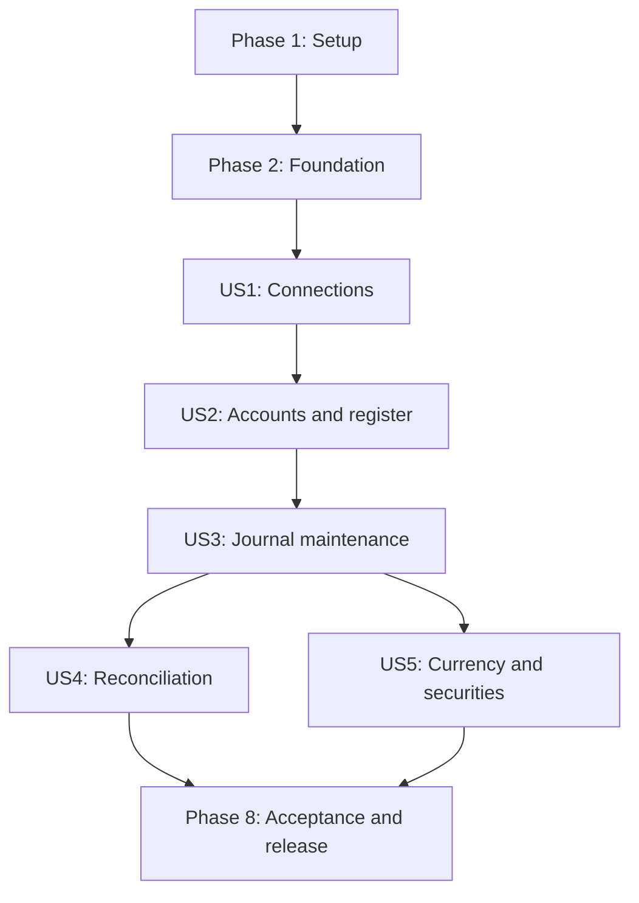

# Tasks: SQL Desktop Foundation

**Input:** [spec.md](spec.md), [plan.md](plan.md), [research.md](research.md),
[data-model.md](data-model.md), [application services](contracts/application-services.md),
[desktop UI](contracts/desktop-ui.md), and [quickstart.md](quickstart.md).

**Organization:** Shared setup, shared foundation, five user stories, then release validation.
Each checkbox is one implementation task. IDs remain stable once work starts.

**Tests:** The spec calls for automated write checks and acceptance evidence. Constitution III
also requires business-rule and SQL boundary tests. Write the listed tests before the related
implementation. Confirm they fail for the missing behavior, then make them pass. A test project
that cannot build is not evidence of a failing behavioral test.

**Format:** `- [ ] Tnnn [P] [USn] Description with file paths`. `[P]` marks work that can run
beside the explicitly named tasks in the parallel examples. It does not bypass prerequisites.
All paths are relative to the repository root. Referenced source files are planned outputs.

**Scope:** Follow research decisions D-001–D-008. Put all procedure calls in
`StoredProcedureRepository`. Use EF for metadata and line reconciliation. Use one hardcoded
expected schema version and one stored integer. Journal controls cover stale-version detection
and atomic writes under FR-017.
Securities remain required by US5. Add no safeguards without a requirement or concrete current risk.

## Phase 1: Setup

**Purpose:** Establish the .NET 10 projects, required tools, and Windows build checks.

- [x] T001 Create `FatStacks.slnx`, `src/FatStacks.Core/FatStacks.Core.csproj`, `src/FatStacks.Infrastructure/FatStacks.Infrastructure.csproj`, and `src/FatStacks.Desktop/FatStacks.Desktop.csproj`. Target Core/Infrastructure at `net10.0` and WPF at `net10.0-windows`. Keep references consistent with the three boundaries in D-001.

- [x] T002 Pin a supported .NET 10 SDK patch in `global.json`. Enable nullable references and repository analyzer settings in `Directory.Build.props` and `.editorconfig`. Select the Microsoft.Testing.Platform runner used by quickstart commands.

- [x] T003 Pin EF Core 10 SQL Server, SqlClient, Autofac, grate, and MSTest versions in the project files and `.config/dotnet-tools.json`. Record purpose, license, transitive footprint, support, and security findings in `docs/dependencies.md` before adoption (D-008).

- [x] T004 Create `tests/FatStacks.Tests/FatStacks.Tests.csproj`, `tests/FatStacks.SqlTests/FatStacks.SqlTests.csproj`, and `tests/FatStacks.WindowsChecks/FatStacks.WindowsChecks.csproj`. Configure MSTest and platform UI Automation references without adding a wrapper framework.

- [x] T005 [P] Copy the required WPF resources, icons, and Fluent license from `.workspace/dotnet-beancount/src/BeancountViewer/` into `src/FatStacks.Desktop/Assets/` and `src/FatStacks.Desktop/App.xaml`. Retain the baseline styles and remove file-parser dependencies.

- [x] T006 [P] Add a Windows restore/build/analyzer/service-test job in `.github/workflows/ci.yml`. Add a SQL Server test job using isolated test credentials, and document the interactive-session requirement for UI tests in `docs/testing.md`. Missing SQL/UI prerequisites must remain visible.

- [x] T007 [P] Document Windows 11 x64, SQL Server 2022+, .NET desktop workload/runtime, restore/build/test/run commands, and external credential setup in `README.md` (Principle II; D-008).

**Checkpoint:** The empty solution restores, builds, and runs its test harnesses on compatible runners.

## Phase 2: Foundation

**Purpose:** Provide shared storage and platform boundaries before user-story work.
The schema tasks reproduce field constraints from the data model verbatim. They also require
single-column keys, bigint identity defaults except singleton rows, tinyint catalogs, date-only
accounting dates, and UTC `CreateDate`/`UpdateDate` columns.

- [x] T008 Create the grate package layout in `database/README.md`, `database/up/`, `database/sprocs/`, `database/views/`, and `database/types/`. Use one-time migrations as the authoritative table definitions; keep no separate copies. Keep applied scripts immutable. Configure `text -merge` for procedure/view definitions in `.gitattributes`. Add `database/permissions/RuntimeRole.sql` for a non-administrator runtime role with required table DML and procedure EXECUTE rights, but no DDL. Apply it explicitly with maintenance privileges after schema deployment. Do not use EF migrations or schema creation (FR-028/033; D-006).

- [x] T009 Create catalogs, Book, and SchemaVersion in `database/up/001_CreateBookAndCatalogs.sql`.

  Catalog constraints:
  “AccountClass | AccountClassId tinyint PK; unique Name; five rows: Assets, Liabilities, Equity, Income, Expenses”;
  “DisplayGroup | DisplayGroupId tinyint PK; unique Name; Banks, Credit Cards, Investments, Expenses, Other”;
  “AccountType | AccountTypeId tinyint PK; unique Name; AccountClassId FK; DefaultDisplayGroupId FK”;
  “Currency | CurrencyId tinyint PK; unique Code char(3); Name; FractionalDigits tinyint”;
  “Bank | Assets | Banks”;
  “Cash | Assets | Banks”;
  “Credit Card | Liabilities | Credit Cards”;
  “Loan Receivable | Assets | Other”;
  “Loan Payable | Liabilities | Other”;
  “Investment/Brokerage | Assets | Investments”;
  “Other Asset | Assets | Other”;
  “Other Liability | Liabilities | Other”;
  “Equity | Equity | Other”;
  “Income | Income | Other”;
  “Expense | Expenses | Expenses”.

  Book constraints:
  “BookId | bigint PK, assigned 1 without IDENTITY; CHECK BookId = 1 permits only one book”;
  “StableIdentifier | uniqueidentifier, NOT NULL, UNIQUE; permanent logical identity”;
  “Name | nvarchar(200), required”;
  “CurrencyId | tinyint FK, required; defaults to USD during setup”;
  “TimeZoneId | nvarchar(100), required; valid Windows TimeZoneInfo ID”;
  “CurrencyLocked | bit, default 0; becomes 1 with the first saved journal entry”;
  “CreateDate, UpdateDate | UTC datetime2(7)”.

  SchemaVersion constraints:
  “SchemaVersion has SchemaVersionId bigint PK, assigned 1 without IDENTITY, with CHECK value = 1.”;
  “Its Version is int NOT NULL.” Seed the five classes, five stored groups, eleven type mappings, USD (2), EUR (2), and JPY (0). Publish schema version 1 only at successful package completion; never seed a user Book in SQL. CurrencyLocked remains true after entries are deleted (FR-007/020/024/032).

- [x] T010 Create Account in `database/up/002_CreateAccounts.sql`.

  Field constraints:
  “AccountId | bigint PK”;
  “BookId | bigint FK”;
  “ParentAccountId | nullable bigint FK to Account”;
  “Name | nvarchar(200), trimmed and nonempty”;
  “AccountTypeId | tinyint FK; fixed after creation in phase 1”;
  “DisplayGroupId | tinyint FK; defaults from type, may be changed”;
  “OpenDate, CloseDate | date; CloseDate nullable”;
  “CreateDate, UpdateDate | UTC datetime2(7)”. Preserve “UNIQUE(BookId, ParentAccountId, Name)” under a case-insensitive collation;
  “CHECK ParentAccountId differs from AccountId.”;
  “CHECK CloseDate is null or later than OpenDate.” Keep foreign keys restrictive (FR-008).

- [x] T011 Create journal tables in `database/up/003_CreateJournal.sql`.

  Header constraints:
  “JournalEntryId | bigint PK; stable identity and equal-date ordering key”;
  “BookId | bigint FK”;
  “AccountingDate | date, required”;
  “BankPostingDate | nullable date, independent of AccountingDate”;
  “Payee | nvarchar(200), optional”;
  “Description | nvarchar(1000), required; may be empty”;
  “EntryKind | tinyint: 0 ordinary, 1 security opening, 2 security transfer”;
  “Version | rowversion”;
  “CreateDate, UpdateDate | UTC datetime2(7)”.

  Line constraints:
  “JournalEntryLineId | bigint PK; preserved on edits”;
  “JournalEntryId | bigint FK”;
  “AccountId | bigint FK”;
  “LineOrder | int, positive; UNIQUE(JournalEntryId, LineOrder)”;
  “Debit, Credit | decimal(10,2), NOT NULL”;
  “ReconciliationStatus | tinyint, NOT NULL, default 0; CHECK value in (0,1,2)”;
  “SecurityId | nullable bigint FK”;
  “Quantity | nullable decimal(18,8), signed movement”;
  “Version | rowversion”;
  “CreateDate, UpdateDate | UTC datetime2(7)”. Enforce “CHECK requires Debit > 0 and Credit = 0, or Credit > 0 and Debit = 0.” Preserve independent rowversions and restrictive foreign keys. Add the three indexes named in data-model.md; the security FK follows the next migration (FR-014/017/019/021).

- [x] T012 Create Security and finish security-line constraints in `database/up/004_CreateSecurities.sql`.

  Fields:
  “SecurityId | bigint PK”;
  “BookId | bigint FK”;
  “Symbol | nvarchar(32), required; UNIQUE(BookId, Symbol)”;
  “Name | nvarchar(200), required”;
  “QuantityPrecision | tinyint, CHECK 0 through 8”;
  “CreateDate, UpdateDate | UTC datetime2(7)”. Enforce “CHECK requires SecurityId and Quantity together, with nonzero Quantity.” Positive quantity accompanies a debit; negative quantity accompanies a credit. Apply these constraints through the one-time migration. Use the schema-version publication step in `database/afterMigration/999_SetSchemaVersion.sql` (FR-025).

- [x] T013 Implement mapped entities, explicit SQL types/lengths, relationships, and rowversion concurrency tokens in `src/FatStacks.Infrastructure/Persistence/BookDbContext.cs` and `src/FatStacks.Infrastructure/Persistence/Entities/`. Match the preceding schema tasks exactly; use assigned singleton keys and one context per operation. Add sanitized failure-category mapping in `src/FatStacks.Infrastructure/Diagnostics/DatabaseErrors.cs`. Disable sensitive-data and private SQL parameter logging (FR-028/029).

- [x] T014 Define UI-independent typed outcomes and operation contracts in `src/FatStacks.Core/Contracts/`. Add operation-scoped context/connection creation in `src/FatStacks.Infrastructure/Persistence/BookDatabase.cs` and the sole procedure-call class in `src/FatStacks.Infrastructure/Persistence/StoredProcedureRepository.cs`. Limit it to typed parameter binding, execution, and result mapping; keep workflows in services (D-001/002).

- [x] T015 Create isolated grate-deployed SQL fixtures in `tests/FatStacks.SqlTests/Fixtures/BookDatabaseFixture.cs` and Windows launch helpers in `tests/FatStacks.WindowsChecks/Fixtures/DesktopFixture.cs`. Separate synthetic fixtures from production configuration. Verify required constraints and runtime DDL denial in `tests/FatStacks.SqlTests/SchemaTests.cs`; record actual test outcomes.

**Checkpoint:** Grate creates an empty compatible schema. EF maps it without creating it.
SQL constraints and the test fixtures work on SQL Server. No story begins before this foundation passes.

## Phase 3: US1 — Connect to the Right Book (P1)

**Goal:** Initialize explicitly, save named profiles, and open one identified book at a time.

**Independent test:** Initialize two empty databases, open/switch/restart, then try an unreachable
profile, wrong Book identity, and mismatched schema version. Expect no leaked records, automatic
schema changes, or fallback connection. The connection dialog remains available after failure.

### Tests

- [x] T016 [P] [US1] Write profile tests in `tests/FatStacks.Tests/Profiles/ProfileTests.cs`: stable GUIDs, case-insensitive unique nonempty names, rename/remove, corrupt configuration, unavailable credential protection, atomic replacement failure, and last-successful-profile behavior (FR-001/002/003/006).

- [x] T017 [P] [US1] Write real SQL connection/setup tests in `tests/FatStacks.SqlTests/Connections/ConnectionTests.cs`: empty/repeated/unrelated/interrupted setup, separate maintenance privileges, stored-version equality, missing/unreadable/mismatched version, distinct Book IDs, and explicit reassociation (FR-005/028/032).

- [ ] T018 [P] [US1] Write session tests in `tests/FatStacks.Tests/Connections/SessionTests.cs` and transport cases in `tests/FatStacks.SqlTests/Connections/TransportTests.cs`. Cover delayed reads, write-target capture, switch cancellation/failure, startup cancellation, valid/no TLS, self-signed/expired certificates, and authentication failure (FR-003/004/030).

### Implementation

- [x] T019 [US1] Implement local profile records and storage in `src/FatStacks.Infrastructure/Configuration/ProfileStore.cs` and `src/FatStacks.Core/Connections/ConnectionProfile.cs`. Preserve “ProfileId GUID”, “unique case-insensitive FriendlyName”, and “ExpectedBookIdentifier GUID” as optional. Store “FormatVersion, Profiles, and LastSuccessfulProfileId” under current-user local application data. Protect secret content with Windows current-user DPAPI and replace settings atomically (FR-001/002/006).

- [x] T020 [US1] Implement EF book setup and explicit grate maintenance in `src/FatStacks.Infrastructure/Connections/DatabaseSetup.cs`. Collect name, currency, and valid Windows time zone; default USD. Use separate transient maintenance credentials. Reject unrelated/incompatible databases and preserve an existing compatible Book on repeated setup. Permit explicit completion when a compatible schema lacks its Book (FR-005/028).

- [x] T021 [US1] Implement `src/FatStacks.Infrastructure/Connections/ConnectionService.cs` and `src/FatStacks.Core/Connections/SchemaCompatibility.cs`. Hardcode expected schema version 1 and compare the stored integer before activation. Fatal version errors leave no active session. Verify expected logical Book identity and require explicit reassociation on mismatch. Keep Test separate from activation (FR-005/032; D-006).

- [x] T022 [US1] Implement SqlClient transport settings and warning results in `src/FatStacks.Infrastructure/Connections/SqlTransport.cs`. Use TLS when available; permit usable plaintext and self-signed/expired-certificate connections with visible non-blocking condition warnings. Preserve authentication/protocol failures; never log secrets (FR-029/030; D-007).

- [x] T023 [US1] Implement `src/FatStacks.Core/Connections/BookSessionCoordinator.cs`: capture connection/book identity per operation, resolve unsaved edits and running writes before switching, cancel old reads, reject old-session results, clear prior UI data, and leave failed switches disconnected. Support save/discard/cancel callbacks without WPF types (FR-003/004).

- [x] T024 [US1] Configure Autofac property injection in `src/FatStacks.Desktop/App.xaml.cs`. Resolve only at composition boundaries, supply required properties before use, own a child scope per active book, and dispose operation contexts and obsolete session resources. Keep WPF updates on the dispatcher (Principles I/V; D-001).

- [x] T025 [US1] Build `src/FatStacks.Desktop/Views/ConnectionWindow.xaml`, `src/FatStacks.Desktop/ViewModels/ConnectionViewModel.cs`, and `src/FatStacks.Desktop/Views/BookSetupWindow.xaml`. Provide profile CRUD, integrated/SQL authentication, Test/Open/Initialize, explicit reassociation, progress/cancel, and non-blocking transport warnings. Show active profile and Book identity in `src/FatStacks.Desktop/MainWindow.xaml` (FR-001–006/030/032).

- [x] T026 [US1] Wire last-successful-profile startup and cancellation in `src/FatStacks.Desktop/ViewModels/StartupViewModel.cs`. Test and failed switches must not replace the remembered ID. Report preference failures independently from a usable connection or committed accounting operation (FR-003/006).

- [ ] T027 [US1] Automate connect/switch/restart/reassociate in `tests/FatStacks.WindowsChecks/ConnectionJourneyTests.cs`. Execute the US1 tests and record SQL/Windows evidence separately in `specs/001-sql-desktop-foundation/validation/us1.md`. Keep unavailable-runner checks marked unverified (SC-001/006).

**Checkpoint:** US1 is a working connection/setup increment. It does not yet provide journal entry editing.

## Phase 4: US2 — Set Up Accounts and Browse the Familiar Register (P1)

**Goal:** Create hierarchical accounts and browse the retained account tree, tabs, register,
search, and details without losing full-history balances.

**Independent test:** Use a synthetic SQL fixture with all five classes, nested/closed accounts,
old openings, equal-date entries, and split lines. Account setup works without journal-editor UI.
Fixture seeding is test-only and does not depend on the US3 procedure implementation.

### Tests

- [x] T028 [P] [US2] Write account/type/calendar tests in `tests/FatStacks.Tests/Accounts/AccountTests.cs` and `tests/FatStacks.Tests/Calendar/BookCalendarTests.cs`. Cover all eleven type mappings, group overrides, stable rename identity, cycles, closure boundaries, daylight-saving transitions, and device-zone independence (FR-007/008/019/024).

- [x] T029 [P] [US2] Write SQL register reference tests in `tests/FatStacks.SqlTests/Register/RegisterTests.cs`. Seed balanced synthetic records directly in a test transaction. Cover older opening balances, description/counter-account case-insensitive search, literal search metacharacters, equal dates, zero-net rows, split details, closed descendants, and aggregate values beyond one-line range (FR-009–012).

### Implementation

- [x] T030 [US2] Implement EF account operations in `src/FatStacks.Infrastructure/Accounts/AccountService.cs` and requests in `src/FatStacks.Core/Accounts/AccountRequests.cs`. Preserve “nvarchar(200), trimmed and nonempty”; disallow colon separators, duplicate siblings, ancestor cycles, and cross-book parents. Keep type fixed, permit group overrides, retain closed history, and reject closure dates invalidating existing lines. Historical edits may keep existing closed references only before closure (FR-007/008).

- [x] T031 [US2] Implement the book calendar and testable clock boundary in `src/FatStacks.Core/Calendar/BookCalendar.cs`. Supply book-local today and the inclusive today-minus-89-days cutoff; keep accounting/bank dates as DateOnly and operational timestamps UTC (FR-019).

- [x] T032 [US2] Implement `database/sprocs/ReadAccountRegister.sql`. Net selected-account lines per entry, calculate full-history running balances before date/search filters, and order by AccountingDate/JournalEntryId. Preserve zero-net rows and return decimal(28,2) monetary aggregates. Keep one current definition (FR-010/011/033; D-004).

- [x] T033 [US2] Add the register procedure call to `src/FatStacks.Infrastructure/Persistence/StoredProcedureRepository.cs`. Implement EF batch balance and detail reads in `src/FatStacks.Infrastructure/Register/RegisterService.cs`. Include every line, closed-account links, and descendant contributions. Map positive net credits to Payment and net debits to Deposit; do not narrow totals (FR-009–012).

- [x] T034 [US2] Build account setup in `src/FatStacks.Desktop/Views/AccountSetupWindow.xaml` and `src/FatStacks.Desktop/ViewModels/AccountSetupViewModel.cs`. Show the type-determined class, parent hierarchy, explicit group override, rename, and close operations. Income and Equity remain reachable under Other (FR-007/008/024).

- [x] T035 [US2] Port the account tree, ordered tabs, register, search, and details into `src/FatStacks.Desktop/MainWindow.xaml` and `src/FatStacks.Desktop/ViewModels/MainWindowViewModel.cs`. Retain P01–P10, P18–P22 from ui-parity.md; show currency and credit/debit tooltips, cancel obsolete searches, and restore selection by identity. Use virtualization and asynchronous reads (FR-009–012).

- [ ] T036 [US2] Automate account creation, register search, closed-account navigation, and refresh in `tests/FatStacks.WindowsChecks/RegisterJourneyTests.cs`. Run the US2 tests and record reference results plus visual comparisons in `specs/001-sql-desktop-foundation/validation/us2.md` (SC-002/003).

- [x] T086 [US2] Fix the Accounts view toggle, preserve the selected account and unsaved draft during filtering and view changes, and sort parent choices by displayed path (M02/M15).
- [x] T087 [US2] Collapse empty connection feedback, alphabetize saved profiles, open a saved profile on double-click, and focus the main register search with Ctrl+F (M05/M09).
- [ ] T088 [US2] Record Windows retest outcomes for M27–M32 in `validation/us2.md` and verify the subsequent fixes in M33–M34.
- [x] T089 [US2] Handle Ctrl+F in the active desktop window before focused controls process it, and add distinct Alt access keys for Connections actions (M32).

**Checkpoint:** US2 can display a correct prepared book and create accounts. Journal-editor actions
become available in US3; disabled actions must not imply an implemented capability.

## Phase 5: US3 — Maintain Balanced Journal Entries (P1)

**Goal:** Create, edit, and physically delete whole balanced entries through the familiar dialogs.

**Independent test:** Enter bank opening 1,000, expense 25, and a split. Edit the expense to 30,
delete it, restart, and compare exact balances. Reject invalid values and stale changes with
no partial writes. Repeated Save while pending sends one request.

### Tests

- [X] T037 [P] [US3] Write financial validation tests in `tests/FatStacks.Tests/Journal/JournalValidationTests.cs`. Cover two positive sides, zero/negative amounts, imbalance, invalid accounts/dates, foreign currency, 99,999,999.99 versus 100,000,000.00, trailing zeros, nonzero excess precision, and totals larger than one line (FR-013–015/019/020).

- [X] T038 [P] [US3] Write procedure and permission tests in `tests/FatStacks.SqlTests/Journal/JournalWriteTests.cs`. Cover exact class reference results, splits, stable IDs, stale header/full-line sets, independent external line changes, literal SQL-like text, create/edit/delete rollback before commit, and runtime success without DDL permissions (FR-015/017/018/028). Use test-controlled SQL failure injection, not a production fault API.

- [X] T039 [P] [US3] Write editor behavior tests in `tests/FatStacks.WindowsChecks/JournalEditorViewModelTests.cs`. Cover field errors, retained drafts, Save busy-state exclusion, Continue date retention, Cancel, and no success for an unconfirmed commit. Test preference-save failure independently from committed accounting (FR-006/016).

### Implementation

- [X] T040 [US3] Implement typed journal requests and boundary validation in `src/FatStacks.Core/Journal/JournalRequests.cs` and `src/FatStacks.Core/Journal/JournalValidation.cs`. Match header/line types and lengths from the foundation tasks. Use decimal and check final values before narrowing parameters; accept value-preserving trailing zeros. Include loaded header/full original-line versions and retain IDs on edits (FR-013–017).

- [X] T041 [US3] Create table-valued parameter definitions in `database/types/JournalEntryLines.sql` and `database/types/JournalEntryLineVersions.sql`. Match final line fields and original line/version sets from the service contract. Deploy types through grate before dependent procedures. Preserve full decimal precision at the service boundary and use typed SQL values (FR-028).

- [X] T042 [US3] Implement ordinary monetary creates/edits in `database/sprocs/SaveJournalEntry.sql`. Use one serializable transaction, validate complete balanced lines, book/account/date rules and loaded versions, preserve line IDs, reset only financially changed line statuses, and lock book currency after first save. Return refreshed versions and reset IDs. Reject security EntryKinds until US5 adds them (FR-014–017/020/023).

- [X] T043 [US3] Implement `database/sprocs/DeleteJournalEntry.sql`. Check the loaded header and complete line set, delete lines before the header in one serializable transaction, and return success only after commit. Use restrictive FKs and physical deletion; do not add soft-delete or retained financial copies (FR-017/018).

- [X] T044 [US3] Add save/delete procedure calls in `src/FatStacks.Infrastructure/Persistence/StoredProcedureRepository.cs` and journal workflows in `src/FatStacks.Core/Journal/JournalService.cs`. Bind every value as a parameter, map conflict/validation/failure results, and keep writes bound to their original session. Refresh successful results without reconstructing identity from row position (FR-003/017/028/029).

- [X] T045 [US3] Implement `src/FatStacks.Desktop/ViewModels/JournalEditorViewModel.cs` and `src/FatStacks.Desktop/Views/JournalEditorWindow.xaml`. Retain account suggestions, split add/remove and Tab behavior, Debit/Credit fields, Ctrl+Enter, Save/Continue/Cancel, busy exclusion, retained drafts, and book-local date defaults. Use field/line errors and stable control IDs (FR-013/016/019; P11–P16).

- [X] T046 [US3] Implement `src/FatStacks.Desktop/Views/DeleteEntryWindow.xaml` and wire journal actions in `src/FatStacks.Desktop/ViewModels/MainWindowViewModel.cs`. Preview date/description/all lines and states with Cancel focused. Restore valid selection after edits/deletes; keep keyboard typing guards (FR-012/018; P10/P11/P17).

- [ ] T047 [US3] Automate opening, expense, split, edit, failed save, Continue, and cancelled/confirmed delete in `tests/FatStacks.WindowsChecks/JournalJourneyTests.cs`. Execute service/SQL/UI cases and record exact reference results and rollback evidence in `specs/001-sql-desktop-foundation/validation/us3.md` (SC-003/004/006).

**US3 execution evidence:** [validation/us3.md](validation/us3.md). T037–T046 are implemented. T047 and overlapping T073 remain open for the Windows execution and parity evidence.

**Checkpoint:** US1–US3 form the first usable monetary-accounting increment. US4 and US5 remain
required for the complete feature.

## Phase 6: US4 — Reconcile Each Account Line (P1)

**Goal:** Change one line's reconciliation status independently while preserving financial values.

**Independent test:** Exercise every pair of Uncleared/Reconciling/Cleared states across a
transfer, then refresh/restart. Check Mixed for multiple selected-account lines and ensure
financial edits reset only changed lines.

### Tests

- [ ] T048 [P] [US4] Write SQL reconciliation tests in `tests/FatStacks.SqlTests/Reconciliation/ReconciliationTests.cs`. Cover all state pairs, status-only unchanged money/dates/accounts, stale versions, simultaneous whole-entry edits, and rollback if the parent update conflicts. Test financial reset and unchanged-line preservation through SaveJournalEntry (FR-017/021–023).

- [ ] T049 [P] [US4] Write selected-account summary tests in `tests/FatStacks.Tests/Reconciliation/ReconciliationSummaryTests.cs`. Mixed is derived only from the selected account lines and never stored; test unrelated counter-account states and repeated lines (FR-022).

### Implementation

- [ ] T050 [US4] Implement `src/FatStacks.Infrastructure/Reconciliation/ReconciliationService.cs` with an ordinary EF transaction. Change one line status using its loaded version and touch the header timestamp using its loaded version; SaveChanges once, commit, and return refreshed versions. Roll back both on conflict; use no procedure (FR-017/021; D-003).

- [ ] T051 [US4] Extend `database/sprocs/ReadAccountRegister.sql` and `src/FatStacks.Core/Reconciliation/ReconciliationSummary.cs` with the selected-account three-state/Mixed summary. Map 0 Uncleared, 1 Reconciling, 2 Cleared; persist no fourth state and change no balance calculation (FR-021/022).

- [ ] T052 [US4] Expose individual status controls in `src/FatStacks.Desktop/Views/JournalEditorWindow.xaml`, `src/FatStacks.Desktop/Views/EntryDetailsView.xaml`, and `src/FatStacks.Desktop/ViewModels/ReconciliationViewModel.cs`. Show individual values for Mixed and explain financially reset lines. Refresh using returned versions (FR-021–023).

- [ ] T053 [US4] Automate independent status changes, Mixed details, financial resets, refresh, and restart in `tests/FatStacks.WindowsChecks/ReconciliationJourneyTests.cs`. Record SQL and Windows results in `specs/001-sql-desktop-foundation/validation/us4.md` (SC-005).

**Checkpoint:** Each account line keeps its own durable state; status updates preserve finances.

## Phase 7: US5 — Keep One Currency per Book and Track Basic Securities (P2)

**Goal:** Support distinct book currencies, security definitions, explicit opening holdings,
and same-security internal transfers without a trading engine.

**Independent test:** Open USD/EUR books separately. In USD, open 1.234567 units at 100.00;
transfer 0.234567 units at 20.00. Expect source 1 unit/80.00 and destination 0.234567 units/20.00.
Reject over-transfers and edits/deletes that invalidate a later holding.

### Tests

- [ ] T054 [P] [US5] Write currency/quantity boundary tests in `tests/FatStacks.Tests/Securities/SecurityValidationTests.cs` and `tests/FatStacks.SqlTests/Securities/HoldingTests.cs`. Cover USD/EUR/JPY precision, cross-book mismatch, permanent currency lock after deletion, 0–8 quantity scale, fractional units, carrying amounts, over-transfer, backdating, and opening edits/deletes that invalidate later activity (FR-020/024–026).

- [ ] T055 [P] [US5] Write metadata/currency-change SQL tests in `tests/FatStacks.SqlTests/Securities/SecuritySetupTests.cs`. Cover unique symbols, required names, precision fixed after use, and currency-change versus first-journal-save atomicity using ordinary EF setup operations (FR-020/025).

### Implementation

- [ ] T056 [US5] Implement EF definitions and quantity validation in `src/FatStacks.Infrastructure/Securities/SecurityService.cs` and `src/FatStacks.Core/Securities/SecurityValidation.cs`. Preserve “nvarchar(32), required; UNIQUE(BookId, Symbol)”, “nvarchar(200), required”, “tinyint, CHECK 0 through 8”, and the “9,999,999,999.99999999” maximum magnitude. Keep declared precision fixed after use; retain identity on rename (FR-025).

- [ ] T057 [US5] Implement EF book settings in `src/FatStacks.Infrastructure/Books/BookSettingsService.cs`. Check CurrencyLocked and update currency in one serializable transaction; reject unsupported catalogs and post-first-entry currency changes even when all entries were deleted. Expose name/time-zone changes without journal version machinery (FR-019/020).

- [ ] T058 [US5] Extend `database/sprocs/SaveJournalEntry.sql` and `database/sprocs/DeleteJournalEntry.sql` for opening and same-security transfer EntryKinds. Validate two-line shapes, Investment/Brokerage holding accounts, Equity opening offset, balanced carrying money, equal/opposite transfer units, and affected old/new holding histories in AccountingDate/JournalEntryId order. Include later entries on edits/deletes. Reject negative positions and stranded zero-unit/nonzero-value positions under the data model rules (FR-025).

- [ ] T059 [US5] Implement derived holdings in `src/FatStacks.Infrastructure/Securities/HoldingQuery.cs` and typed opening/transfer workflows in `src/FatStacks.Core/Securities/HoldingService.cs`. Sum by AccountId/SecurityId without a holding table or balance override; return decimal(28,8) units and decimal(28,2) carrying amounts. Route journal procedure execution through `src/FatStacks.Infrastructure/Persistence/StoredProcedureRepository.cs` (FR-024/025).

- [ ] T060 [US5] Build `src/FatStacks.Desktop/Views/SecuritySetupWindow.xaml`, `src/FatStacks.Desktop/Views/HoldingEntryWindow.xaml`, `src/FatStacks.Desktop/Views/BookSettingsWindow.xaml`, and their view models under `src/FatStacks.Desktop/ViewModels/`. Display quantity at declared precision, carrying amounts in book currency, and only supported opening/transfer actions. Expose no trades, prices, lots, gains, shorts, or conversion (FR-020/025/026).

- [ ] T061 [US5] Automate definition/opening/transfer and currency rejection in `tests/FatStacks.WindowsChecks/SecurityJourneyTests.cs`. Rerun monetary/reconciliation regressions after procedure changes. Record exact unit/value conservation and holding-history rejection results in `specs/001-sql-desktop-foundation/validation/us5.md` (SC-003/007).

**Checkpoint:** All five stories work. Quantities and money retain their separate meaning and precision.

## Phase 8: Cross-Cutting Validation and Release

**Purpose:** Verify the confirmed scope on SQL Server and Windows, then document delivery.
These tasks introduce no new safety subsystem.

- [ ] T062 Add diagnostic sentinel tests in `tests/FatStacks.SqlTests/Diagnostics/RedactionTests.cs` and `tests/FatStacks.WindowsChecks/DiagnosticsTests.cs`. Exercise application/SQL/global exception paths and verify passwords, account numbers, financial text, tokens, connection secrets, and SQL parameter values never appear in output. Correct the affected logging paths without adding encrypted logging (FR-029/031).

- [ ] T063 [P] Verify SQL-definition `text -merge` behavior in `tests/FatStacks.Tests/Deployment/DefinitionMergeTests.cs` using temporary Git fixtures. Confirm readable diffs and conflicts for non-overlapping edits to one procedure/view. Verify repeatable procedure/view definitions match deployed objects and applied one-time table migrations stay immutable (FR-033).

- [ ] T064 [P] Run the complete P01–P22 matrix and keyboard/high-DPI/focus/accessibility checks on Windows. Store comparisons and per-row results in `specs/001-sql-desktop-foundation/validation/ui-parity.md`. Record reasons and repeatable manual steps for automation gaps; document justified departures and any baseline defects (FR-009/027; SC-002).

- [ ] T065 [P] Create the synthetic 100-account/10,000-entry fixture in `tests/FatStacks.SqlTests/Fixtures/RepresentativeBook.cs` and measure selection/search/refresh for 20 runs each on the agreed Windows machine. Record hardware, SQL placement, cache conditions, and each result in `specs/001-sql-desktop-foundation/validation/performance.md`. Require 19/20 within two seconds per operation; retain all required history and behavior (SC-008).

- [ ] T066 Run restore, build, analyzers, service tests, SQL tests, and Windows journeys from `specs/001-sql-desktop-foundation/quickstart.md`. Record executed/passed/failed/unverified checks and FR-001–FR-033/SC-001–SC-008 evidence in `specs/001-sql-desktop-foundation/validation/acceptance.md`. Update the source-review disposition and record the constitution self-review (FR-027; Principle III).

- [ ] T067 Publish the framework-dependent Windows x64 build with assets, licenses, and grate package using `scripts/Publish-Windows.ps1`. Document desktop-runtime installation, settings location, closed-app file replacement, explicit schema upgrades/version increments, and migration-specific recovery effects in `docs/releases/phase-1.md`. Do not add server provisioning, backup management, or automatic schema recovery (FR-031/032).

- [ ] T068 Replace planned commands with verified setup/run guidance in `README.md` and `specs/001-sql-desktop-foundation/quickstart.md`. Record release version, dependency/security review results, remaining validation limits, and final acceptance in `specs/001-sql-desktop-foundation/validation/acceptance.md` and `specs/001-sql-desktop-foundation/decisions-ledger.md`.

## Dependencies and Execution Order

The graph shows completion order for the application. US2 uses prepared fixtures to test reads
without US3. US3 needs US2 account selection and register refresh. US4 and US5 share journal
procedure/view files; execute their integration changes sequentially even though their separate
test files can be prepared together. Foundation creates the full base schema so US1 deploys a
compatible package without depending on unfinished business workflows.

Within a phase, follow task order except for the parallel groups below. `[P]` test tasks can be
written together after the preceding phase passes. Their implementations still follow the test
contracts. Complete each phase's checkpoint before claiming its story passes. Later phases that
extend a procedure must rerun earlier story tests.

## Parallel Execution Examples

These examples describe optional scheduling. They do not require subagents or extra tooling.

| Phase/story | Tasks that can run together | Prerequisite                                       |
| ----------- | --------------------------- | -------------------------------------------------- |
| Setup       | T005, T006, T007            | Project files and test harnesses exist             |
| US1         | T016, T017, T018            | Foundation passes                                  |
| US2         | T028, T029                  | US1 passes                                         |
| US3         | T037, T038, T039            | US2 passes                                         |
| US4         | T048, T049                  | US3 passes                                         |
| US5         | T054, T055                  | US3 passes; serialize shared edits with US4        |
| Final       | T063, T064, T065            | All stories pass; separate test sessions/databases |

## Implementation Strategy

1. Deliver Setup, Foundation, and US1 as the connection/setup MVP. Validate two-book isolation
   before adding financial workflows. This MVP is not yet a complete accounting application.
2. Add US2 prepared-book browsing, then US3 journal maintenance. This produces the first usable
   monetary-accounting increment. Verify exact reference amounts before adding further workflows.
3. Add US4 reconciliation and US5 required security workflows. Keep securities in scope until
   an explicit requirement change authorizes deferral.
4. Complete cross-cutting checks and release documentation. Keep Windows evidence, SQL behavior,
   synthetic tests, and measured performance distinct. Report unexecuted checks as unverified.

## Requirement Coverage

| Requirement group                                           | Primary phase                                   |
| ----------------------------------------------------------- | ----------------------------------------------- |
| FR-001–006: profiles, session, initialization               | US1                                             |
| FR-007–012: account setup, parity, register/details         | US2                                             |
| FR-013–019: journal validation, atomicity, versions, editor | US3; calendar starts in US2                     |
| FR-020: one book currency and permanent lock                | Foundation, US1 setup, US3 writes, US5 settings |
| FR-021–023: line reconciliation and resets                  | US3 reset behavior; US4 workflow                |
| FR-024–026: separate concepts and basic securities          | Foundation catalogs; US2 account types; US5     |
| FR-027: architecture review and disposition                 | Plan's R01–R14 responses; final acceptance      |
| FR-028: parameterized access and privilege separation       | Foundation, US1, US3, final acceptance          |
| FR-029/030: redaction and non-blocking TLS warnings         | Foundation, US1, final diagnostics tests        |
| FR-031: single-user exclusions                              | Scope rules and final release tasks             |
| FR-032: exact integer schema compatibility                  | Foundation and US1                              |
| FR-033: definitions and deliberate merge resolution         | Foundation and final merge validation           |

## Task Counts and Generation Checks

68 tasks total: 22 shared setup/foundation/release tasks; US1: 12, US2: 9, US3: 11, US4: 6, US5: 8.

Generation review checks task IDs, checkbox format, story labels, paths, dependency order,
and requirement coverage. It does not execute the proposed application or tests.

## Phase 9: Convergence

**Purpose:** Close gaps found by assessing the current implementation against this feature's
specification, plan, tasks, and constitution. This assessment covers all five stories.
US2–US5 remain required even though the first implementation pass stopped at US1.

These tasks reference existing work. If an earlier task closes a gap, verify its result instead
of adding a second implementation. Follow the original dependency order for account, register,
journal, reconciliation, and security work. The two constitution corrections come first.
Use ordinary validation, EF operations, transactions, and SQL constraints where they fit.
Add no new safety subsystem.

- [x] T069 CRITICAL — F01: Validate deserialized profile records in `src/FatStacks.Infrastructure/Configuration/ProfileStore.cs` before reading their fields. A configuration with `Profiles: [null]` currently causes an uncaught NullReferenceException. Return a redacted configuration failure, preserve the file, and prevent accidental replacement. Reset the unreadable state after a successful explicit recovery, including a subsequent missing-file load. Add focused malformed-record and recovery tests in `tests/FatStacks.Tests/Profiles/ProfileTests.cs`. Use ordinary null/shape checks per Constitution IV, FR-001/006, and the corrupt-configuration edge case (contradicts).

- [x] T070 CRITICAL — F02: Prefer TLS in `src/FatStacks.Infrastructure/Connections/SqlTransport.cs` even when the profile permits plaintext fallback. `ConnectionViewModel.Settings` currently selects Encrypt=Optional immediately when that option is checked. Attempt TLS first; allow the required fallback only when encryption is unavailable. Preserve non-blocking self-signed/expired-certificate handling and authentication failures. Add a regression case with fallback permitted and TLS available per Constitution IV, FR-030, plan: TLS warnings, and T022 (contradicts).

- [x] T071 CRITICAL — F03: Complete the absent account operations and setup screen from T028, T030, and T034 in `src/FatStacks.Core/Accounts/`, `src/FatStacks.Infrastructure/Accounts/AccountService.cs`, and the Desktop account setup view/view model. Verify all eleven type mappings, group overrides, stable identity, hierarchy rules, closure boundaries, and retained history with service/SQL tests. Use the existing catalogs and ordinary EF operations per FR-007/008/024 and US2/AC1–5 (missing).

- [ ] T072 CRITICAL — F04: Complete the absent calendar, register read procedure, register service, and account-tree/register/details UI from T028/029/031–036. Implement `BookCalendar`, `database/sprocs/ReadAccountRegister.sql`, `RegisterService`, the procedure binding in `StoredProcedureRepository`, and `MainWindowViewModel`. Verify full-history balances before filtering, book-local dates, Payment/Deposit mapping, deterministic order, closed descendants, complete details, and stable selection. Record reference and Windows results per FR-009–012/019, US2/AC6–10, and plan: register read procedure (missing).

- [ ] T073 CRITICAL — F05: Complete the absent monetary journal implementation and tests from T037–047 in `src/FatStacks.Core/Journal/`, `database/types/`, `database/sprocs/SaveJournalEntry.sql`, `database/sprocs/DeleteJournalEntry.sql`, `StoredProcedureRepository`, and the Desktop editor/delete views. Verify boundary precision, balanced atomic writes, complete loaded-version checks, stable line IDs, permanent currency locking, reset statuses, retained drafts, pending-save exclusion, Continue, and confirmed deletion. Keep every procedure call in the shared repository. Use the specified SQL transactions without an uncertain-outcome framework per FR-013–020/023/028/029, US3/AC1–10, and plan: journal save/delete procedures (missing).

- [ ] T074 CRITICAL — F06: Complete the absent reconciliation implementation and tests from T048–053 after journal maintenance works. Add `ReconciliationService`, `ReconciliationSummary`, the register summary, and individual Desktop status controls. Update one line and its header in an ordinary EF transaction using loaded versions. Verify independent states, Mixed derived only from selected-account lines, unchanged finances, conflict rollback, and resets after financial edits per FR-017/021–023, US4/AC1–5, and plan: EF reconciliation transaction (missing).

- [x] T075 HIGH — F07: Separate manual Open from incidental profile persistence in `src/FatStacks.Desktop/ViewModels/ConnectionViewModel.cs`. Its current early return after `SaveProfileAsync` prevents opening a usable saved profile when preferences cannot be written. Preserve accurate failure reporting for explicit Save, and report a failed remember/profile write independently from successful activation. Add a view-model regression with a readable profile store whose writes fail; verify active-book usability and the warning per FR-006, US1/AC13, and T026 (partial).

- [ ] T076 HIGH — F08: Complete the US1 behavioral checks omitted from T016/018 and execute T027 on Windows. Cover stable IDs after connection edits, active-profile removal rejection, Test preserving the startup preference, save/discard/cancel outcomes, identity pin retention after reload, and startup cancellation. Run `ConnectionJourneyTests` and `WindowBehaviorTests`, including main-window close with an active book and during startup. Record actual SQL, Windows, DPAPI, keyboard/focus, and close-regression results separately in `specs/001-sql-desktop-foundation/validation/us1.md`. Leave unavailable checks unverified per FR-001–006/032, US1/AC1–13, and SC-001/006 (partial).

- [ ] T077 HIGH — F09: Strengthen and execute `tests/FatStacks.SqlTests/Connections/TransportTests.cs` for T018/022. Supply dedicated trusted-TLS, plaintext, self-signed, and expired-certificate fixtures. Verify actual encryption, automatic fallback with certificate checking initially enabled, condition-specific warnings, and preserved authentication/protocol failures. The current matrix accepts any warning and permits fixtures that bypass certificate validation in advance. Record each scenario separately in `validation/us1.md`; missing fixtures remain unverified per FR-030 and plan: TLS warnings and redacted diagnostics (partial).

- [ ] T078 HIGH — F10: Complete the absent book settings, security definitions, derived holdings, opening/transfer workflows, and Desktop screens from T054–061. Implement the planned `Books/`, `Securities/`, and holding-query components. Extend the shared journal procedures and repository bindings, without a separate holding table. Verify declared quantity precision, currency lock after deletion, unit/value conservation, over-transfer rejection, and affected later history on edits/deletes. Run monetary and reconciliation regressions per FR-020/024–026, US5/AC1–6, and plan: currency-change EF transaction and security-history checks (missing).

- [ ] T079 HIGH — F11: Implement the diagnostic sentinel checks from T062 in `tests/FatStacks.SqlTests/Diagnostics/RedactionTests.cs` and `tests/FatStacks.WindowsChecks/DiagnosticsTests.cs`. Exercise application, SQL, and global exception paths. Verify sensitive financial text, passwords, account numbers, tokens, secret-bearing connections, and parameter values are absent from output. Correct only observed logging failures; add no encrypted logging subsystem per FR-029/031 and T062 (missing).

- [ ] T080 HIGH — F12: Execute the P01–P22 parity and accessibility checks from T064 after the required screens exist. Record behavioral results, visual comparisons, keyboard/typing guards, focus, high-DPI layout, and virtualization in `specs/001-sql-desktop-foundation/validation/ui-parity.md`. The current placeholder shell is not evidence of register/editor parity. Document any accepted departures and repeatable manual checks per FR-009/027, SC-002, and T064 (missing).

- [ ] T081 HIGH — F13: Complete the feature-wide acceptance report from T066/068 after the dependent work passes. Create `specs/001-sql-desktop-foundation/validation/acceptance.md` with FR-001–FR-033 and SC-001–SC-008 evidence. Execute the documented build, service, SQL, and Windows checks; retain skipped/unavailable results as unverified. Record exact financial references, rollback/conflict results, source-review disposition, and the constitution self-review. The existing US1 report alone does not establish full-feature acceptance per T066/068 and plan: delivery and verification order (missing).

- [ ] T082 MEDIUM — F14: Implement the missing definition-merge checks from T063 in `tests/FatStacks.Tests/Deployment/DefinitionMergeTests.cs`. Use temporary test repositories to verify readable text diffs and deliberate conflicts for non-overlapping edits to one procedure/view. Verify current procedure/view definitions agree with deployed objects and applied one-time table migrations remain immutable. Preserve the existing `text -merge` attributes per FR-033 and T063 (missing).

- [ ] T083 MEDIUM — F15: Create the representative 100-account/10,000-entry fixture and execute the measurements from T065. Record 20 runs each for selection, search, and refresh, with hardware, SQL placement, and cache conditions in `specs/001-sql-desktop-foundation/validation/performance.md`. Check the 19-of-20 two-second target without dropping required history or behavior per SC-008, plan: performance/scale, and T065 (missing).

- [ ] T084 MEDIUM — F16: Complete the absent Windows publish script and release guidance from T067/068 in `scripts/Publish-Windows.ps1` and `docs/releases/phase-1.md`. Package the framework-dependent Windows x64 application, assets, licenses, and grate files. Verify the package on Windows and document its version, desktop runtime, settings location, closed-app updates, explicit schema compatibility/maintenance, and migration-specific recovery limits. Update verified README/quickstart guidance per plan: migration, installation, and recovery, FR-031/032, and T067/068 (missing).

- [x] T085 MEDIUM — F17: Refresh the shell's displayed friendly name after the active profile is renamed. `MainWindow.Render` currently reads the immutable name captured when the session opened, while profile Save only updates configuration. Preserve the active connection, profile ID, and logical book identity; update only the displayed profile metadata. Add a Windows/view-model check that renames an active profile, closes Connections, and verifies the new name without reconnecting per FR-001/003, US1/AC6/10/11, and T025 (partial).

## Phase 10: Convergence

- [x] T090 [US2] F18. Record the approved five-tab sidebar in the spec, accounting model, data model, parity baseline, and validation steps. Preserve stored display groups and document the Loans Payable and Other routing. Retest the revised M06 under T094 (FR-007/009/024, US2/AC3–5, T035/P03–P04).
- [X] T091 [US2] CRITICAL — F19 (contradicts). Use the desktop app's existing .NET `Trace.TraceError` pattern for handled failures.
  - Cover account load and save, register refresh and search, and entry detail load.
  - Include a fixed operation name and a safe error category in each event. Keep the existing UI messages. Omit events for routine cancellation.
  - Verify that failure events reach a trace listener. Check that the events contain no raw exception text, search terms, financial data, credentials, or connection strings.
  - Defer the persistent rolling log file to Phase 2.
  - References — Constitution V, FR-029, and the plan's redacted diagnostics decision.
- [X] T092 [US2] HIGH — F20 (partial). Update search in `database/sprocs/ReadAccountRegister.sql`.
  - Match the search term against the description or each counter-account path separately. Keep the joined names for display.
  - Add a SQL regression test for a term that spans two joined names. Verify that this term does not match across names.
  - Verify that literal search matching and full-history balances still work.
  - References — FR-011, US2/AC7, P08, T029, and T032.
- [X] T093 [US2] HIGH — F21 (partial). Preserve transaction selection by stable entry ID during overlapping refreshes in `MainWindowViewModel.cs`.
  - Add a regression test with a delayed read. Select an entry and start two overlapping refreshes.
  - Verify that the latest result restores the selection if the entry still exists.
  - Verify that changing the account or book does not restore an obsolete selection.
  - References — FR-012, US2/AC10, P10, T035, and T072.
- [ ] T094 [US2] HIGH — F22 (partial). Complete US2 validation on Windows.
  - Update `validation/us2.md` with the checked outcomes for M33 and M34. Keep the M32 failure in the test history.
  - Use the Windows UI with a populated synthetic book. Check register search, closed-account links, and refresh.
  - Record the manual results for M21 through M26 when journal entry creation is available.
  - Run the revised M06. Record the outstanding US2 comparisons for appearance, keyboard operation, scaling, and accessibility in the parity evidence. Record approved departures there where applicable.
  - Automate keyboard regression checks on Windows where practical. Record repeatable manual steps for the remaining checks.
  - References — Constitution III, SC-002, SC-003, T036, T072, and T088.
- [X] T095 [US2] MEDIUM — F23 (partial). Complete the register performance checks from T065 and T083.
  - Use the shared fixture with 100 accounts and 10,000 entries on the agreed Windows machine.
  - Measure 20 runs for each operation. Measure account selection, search, and refresh.
  - Record the hardware and SQL Server placement in `validation/performance.md`. For each operation, record how many runs finish within two seconds.
  - References — SC-008 and the plan's performance validation.

## Phase 11: Convergence

- [X] T096 [US2] HIGH - F24 (partial). Preserve the selected account when Reload finds it in a different sidebar tab after a display-group change. Select the destination tab and restore the selected transaction if it still appears in the register. Add a regression that moves the selected account between tabs and verifies both stable IDs after refresh. Follow FR-007, FR-012, US2/AC5, US2/AC10, P10, and T035.
- [ ] T097 [US2] HIGH - F25 (partial). Reconcile the remaining Windows evidence under T036, T072, and T094. Record the revised M06 pass and link the successful benchmark run in `validation/us2.md`. Record results for the populated-book Windows register automation and outstanding visual, keyboard, scaling, and accessibility comparisons. Record M21 through M26 when journal entry creation is available. Keep the deferred checks visible until they run. Follow Constitution III, SC-002, and SC-003.

## Phase 12: US3 desktop follow-up

- [ ] T098 [US3] Correct journal-editor keyboard navigation in `src/FatStacks.Desktop/Views/JournalEditorWindow.xaml`, its code-behind, and the account picker as needed. Tab from Description must focus the first posting account input, then traverse Account, Debit, Credit by row; Shift+Tab must reverse the order. Keep add/remove posting and save actions keyboard accessible, preserve suggestion acceptance and Tab-to-add behavior, and skip noninteractive layout/error areas. Add Windows focus-navigation regressions in `tests/FatStacks.WindowsChecks/JournalEditorViewModelTests.cs` and record an interactive Windows keyboard pass in `validation/us3.md`. Follow FR-013, US3 keyboard acceptance, and P13–P15.

T098 implementation and Windows regression source are complete. Its interactive Windows verification remains pending; see [US3 validation](validation/us3.md#journal-keyboard-and-presentation-fixes).

- [X] T099 [US3] Add journal date shortcuts for both accounting and bank posting inputs: `-` previous day, `+` next day, and `T`/`t` current book-local today. Use current displayed dates, anchor empty fields at book-local today, preserve the other date, and handle invalid text/date limits without crashing. Inject the book calendar, add portable calendar-boundary/time-zone tests and a Windows text-input regression, and record Windows execution as pending in `validation/us3.md`.

- [X] T100 [US3] Include Payee in `ReadAccountRegister` and its repository/model mapping. Display payee followed by optional italic description in the dense register and selected-entry summary; show either field independently without empty separators, and expose full text through tooltips/accessibility. Add portable presentation, SQL result-mapping/balance, and Windows template regressions; record Windows execution as pending and document deployment of the updated read procedure for existing books.

- [X] T101 [US3] Add account-Type name-prefix selection in the Accounts dialog, return journal Continue focus to Date after confirmed success while retaining the saved date, select all posting-account text on focus, and format exact monetary inputs to two decimal places on focus loss without hiding invalid precision. Add portable formatting cases and Windows prefix/focus/Continue/amount regressions. Record Windows execution separately in `validation/us3.md`.

## Phase 13: Convergence

**Scope:** US3 only, including its shared account-selection, register-display, diagnostic, and Windows-validation obligations. This assessment covers T037–T047, T073, T098–T101, and the US3 portions of shared tasks. It does not add US4 reconciliation controls, US5 security workflows, or feature-wide release work. Assess the resulting behavior when these tasks overlap earlier open tasks; do not create a second implementation.

- [X] T102 [US3] CRITICAL — F26. Reject monetary precision loss before converting journal draft text to decimal in `src/FatStacks.Desktop/ViewModels/JournalEditorViewModel.cs`. `Request()` currently calls `decimal.TryParse` directly, although `FormatAmount()` already recognizes that parsing can round long fractional input. A debit of `1.000000000000000000000000000001` can become 1 before Core validation and balance against a credit of 1. Apply exact-input validation on every Save/Continue path, preserve the original draft and field/line error, and dispatch no write for nonzero excess precision. Continue accepting value-preserving trailing zeros and supported culture-specific separators. Reuse a focused parsing/precision check rather than introducing a money type or another persistence framework. Add editor-to-service regression coverage that proves both amounts and dispatch counts, including direct Save without prior focus loss and the existing two-decimal formatting path. Follow Constitution VI and monetary precision constraints, FR-014, SC-007, US3/AC2/AC11, and T037/T040/T045/T101 (contradicts).

- [X] T103 [US3] CRITICAL — F27. Complete redacted diagnostic coverage for journal operations that fail outside the already traced SQL save/delete calls. Inspect `src/FatStacks.Core/Journal/JournalService.cs`, `src/FatStacks.Desktop/ViewModels/MainWindowViewModel.cs` (`LoadSelectedEntryAsync`), `src/FatStacks.Desktop/ViewModels/JournalEditorViewModel.cs`, and `src/FatStacks.Desktop/Views/DeleteEntryWindow.xaml.cs`. The current catch paths can return failure or show a message without recording the operation. Use the existing .NET trace convention with fixed operation names and safe failure categories. Keep Core independent of Desktop/Infrastructure types, omit routine cancellation events, and avoid duplicate reporting of a failure already traced by the repository. Add focused listener/sentinel tests for journal load, account reads before write dispatch, and handled editor/delete failures. Verify that exception text, financial text, credentials, connection strings, and parameters are absent. Cover only the US3 portion of T062/T079; add no logging framework or persistent-log subsystem. Follow Constitution V, FR-029, plan: redacted diagnostics, and T044/T045/T046 (partial).

- [X] T104 [US3] HIGH — F28. Make posting-account eligibility consistent across the journal picker, application validation, and SQL boundary in `src/FatStacks.Desktop/ViewModels/JournalEditorViewModel.cs`, `src/FatStacks.Desktop/Views/AccountComboBox.cs`, `src/FatStacks.Core/Journal/JournalValidation.cs`, and the journal service as needed. The editor builds every row's suggestions from all accounts, including closed accounts, and Core currently passes `line.LineId is not null` as the existing-reference check without checking the loaded account for that line. Exclude closed accounts from new-reference selection, retain an existing closed reference only on its original line/account before closure, and refresh eligibility when the accounting date changes. Preserve closed historical labels and the SQL procedure's authoritative validation/version checks. Return field/line feedback that distinguishes an unknown account, a date before opening, and an ineligible closed reference. Add regressions for new lines, retained historical references, an existing line reassigned to a different closed account, and date changes; verify rejected requests leave SQL data unchanged. Follow FR-008/013/019, US3/AC2, T040/T042/T045, and plan: account date rules (partial).

- [ ] T105 [US3] HIGH — F29. Complete the remaining US3 Windows execution and evidence from T047/T073/T098 and the Windows portions of T099–T101. Run `JournalJourneyTests`, `JournalEditorViewModelTests`, the journal/register-summary/close-shortcut cases in `WindowBehaviorTests`, and the type-prefix case in `AccountSetupWindowTests` on an interactive Windows runner with isolated SQL fixtures. Verify opening, expense, split, edit, failed/conflicting and unconfirmed saves, pending-save exclusion, Continue date retention/focus, date shortcuts, account replacement search, amount formatting, cancelled/confirmed deletion, restart, selection restoration, and payee/italic-description rendering. Fix observed failures and rerun the relevant portable/SQL regressions after implementation changes. Record exact financial results and target-run outcomes in `specs/001-sql-desktop-foundation/validation/us3.md`; record the US3-affected P07, P10–P17, and P22 visual, keyboard, focus, accessibility, long-split, and high-DPI evidence in `validation/ui-parity.md`, with reasons and repeatable steps for automation gaps. Reconcile overlapping task completion only when supported by those results; keep unavailable checks unverified. Follow SC-002/003/004/006, US3/AC1–AC12, FR-009/012/013/016/018/019/023, and plan: Windows acceptance evidence (partial).

- [ ] T106 [US3] MEDIUM — F30. Explain financial-edit reconciliation resets using visible account/line context in `src/FatStacks.Desktop/ViewModels/JournalEditorViewModel.cs` and `src/FatStacks.Desktop/ViewModels/MainWindowViewModel.cs`. Current notices join `ResetLineIds` into a string, but those database line IDs are not otherwise visible in the editor. Map returned IDs to the saved line orders and displayed account paths so the owner can identify which lines became Uncleared. Preserve unchanged statuses, stable identities, and the existing SQL reset rules; add no US4 status-editing controls. Add presentation regressions for one reset line, multiple resets, unchanged lines, and Save/Continue notices, then include the rendered result in US3 Windows evidence. Follow FR-023, T042/T045/T073, and plan: financial edit status resets (partial).

**Phase 13 execution status:** T102–T104 are complete with portable and real SQL regression evidence. T106's notice implementation and six portable presentation cases are complete; its rendered Windows evidence remains pending under T105, so T106 stays open. The Linux WindowsChecks host exits 150 before executing tests because Microsoft.WindowsDesktop.App is unavailable. T047, T073, T098, and T105 remain open for target-platform evidence. See [US3 validation](validation/us3.md#phase-13-convergence-implementation) and the [US3 parity checklist](validation/ui-parity.md).

## Phase 14: Convergence

**Scope:** US3 only. Current code assessment found no additional implementation remediation beyond completing the outstanding Windows acceptance obligations. This task consolidates the remaining evidence from T047/T073/T098/T105/T106; it does not request another implementation of their completed behavior.

- [ ] T107 [US3] HIGH — F31 (partial). Complete the remaining acceptance checks on the Windows target platform.
  - Use an interactive Windows runner with the .NET 10 desktop runtime. Use isolated SQL test fixtures with synthetic data.
  - Run the US3 automated tests and manual checks in `specs/001-sql-desktop-foundation/validation/ui-parity.md`. Include all the checks below.
  - Check journal creation, editing, and deletion. Check failed saves, saves with conflicts, and saves whose outcome is unconfirmed. Check the guards that apply while a write is pending.
  - Check that keyboard input reaches the correct control. Check account replacement, the date and focus after Continue, date shortcuts, and amount formatting.
  - Check that the register displays the payee and uses italic text for the description. Check refresh, selection, and restart behavior.
  - Check the reset notices that are already implemented. Make sure each notice identifies the affected line by its order and account path.
  - Record the runner versions, actual test totals, exact financial results, observed failures, and their resolutions in `validation/us3.md`.
  - Record evidence for P07, P10–P17, and P22 in `validation/ui-parity.md`. Include appearance, focus, accessibility, long splits, and high-DPI display checks.
  - Correct observed failures. Run the affected checks again. If code changes, also run the relevant portable and SQL regression tests again.
  - Update the overlapping completion claims for T047, T073, T098, T105, and T106 only when these results support the updates.
  - Do not use the existing cross-build, 99 portable test passes, or 13 real SQL test passes as proof of Windows acceptance. Keep checks that cannot run marked as unverified.
  - Follow SC-002/003/004/006, US3/AC1–AC12, and FR-009/012/013/016/018/019/023. Also follow the FR-023 reset presentation requirement under T106 and the plan's Windows acceptance evidence requirement.

## Phase 15: Convergence

**Assessment:** Review the current implementation against all five stories. The new editor
criteria come from `spec.md`. Apply the detailed presentation rules in
[the desktop UI contract](contracts/desktop-ui.md#entry-editor-and-delete) to T109–T112 and T116.
Use `mockups/journal.html` as a visual reference for those criteria, not as a source of additional requirements.

**Execution:** Complete each remaining obligation once. The tasks below reference earlier
open tasks where the work overlaps. Preserve completed behavior and recorded test results.
Earlier task checkboxes do not establish that the current requirements are satisfied.

**Order:** T109 establishes the row layout used by T110–T112. Complete those editor changes
before T116 verifies them. Complete T108 before security reconciliation checks under T113.
Complete T114–T119 as their required implementations become available. Finish the acceptance
report in T117 after the relevant verification and package checks.

**US3 execution status (2026-11-24):** The code and regression tests for T109–T112 are
implemented. Their Windows verification remains pending, so these task boxes remain open.
The US3 portions of T116 and the outstanding target checks in T107 also remain open.
The solution cross-build passes with no warnings or errors. All 107 portable tests pass.
WindowsChecks cannot start on this Linux runner. The 13 SQL journal/register cases fail
during fixture setup before their assertions run. See [the execution evidence](validation/us3.md#phase-15-editor-implementation).
US4, US5, and feature-wide release work were not part of this implementation pass.

- [ ] T108 [US4] CRITICAL — F32. Complete independent line reconciliation per FR-017/021–023, US4/AC1–AC5, plan: EF reconciliation transaction, and T048–T053/T074 (missing).
  - Implement `src/FatStacks.Infrastructure/Reconciliation/ReconciliationService.cs` and the required Core contracts.
  - Change one line's status in an EF transaction using the loaded line and header versions. Update the header version in the same transaction.
  - Return the refreshed versions on success. Roll back both changes on a conflict.
  - Add accessible status controls in the entry details and the required Desktop view model. Keep the journal editor's C column read-only, as FR-013 now requires.
  - Complete the selected-account summary in `database/sprocs/ReadAccountRegister.sql` and `src/FatStacks.Core/Reconciliation/ReconciliationSummary.cs`.
  - Derive Mixed only from the selected account's lines. Do not store a fourth status.
  - Verify every transition between Uncleared, Reconciling, and Cleared. Verify independent states after refresh and restart.
  - Verify that status-only changes preserve dates, accounts, money, and balances. Verify conflicts, rollback, and financial-edit resets through the existing journal procedures.
  - Complete the tests and evidence specified in T048–T053. Do not implement a statement reconciliation wizard.

- [ ] T109 [US3] HIGH — F33. Add numbered posting rows and row tracking per FR-013, US3/AC3, and T045 (missing).
  - Update `src/FatStacks.Desktop/Views/JournalEditorWindow.xaml` and `src/FatStacks.Desktop/ViewModels/JournalEditorViewModel.cs`.
  - Show a 1-based line number before Account. Update the displayed sequence after a row is added or removed.
  - Apply a continuous `#F0F8FC` stripe to even-numbered posting rows. Apply a full-row `#DDEBFA` band when the row is hovered or contains keyboard focus.
  - Keep posting text inputs white (`#FFFFFF`) in both states.
  - Keep six columns in this order: line number, Account, C, Debit, Credit, and Remove (`×`). Center the Debit and Credit headings.
  - Keep the read-only C column between Account and Debit. Preserve blank, R, and checkmark markers with full status names in tooltips and accessibility text.
  - Preserve right-aligned amounts and clearing of the opposite amount when nonempty text is entered.
  - Preserve stable control identities and account suggestions. Keep Tab and Shift+Tab in the specified order without stopping on row numbers or status markers.
  - Verify numbering after row changes and keyboard navigation through a long split in `tests/FatStacks.WindowsChecks/JournalEditorViewModelTests.cs`.

- [ ] T110 [US3] HIGH — F34. Replace the single balance summary with an aligned totals footing per FR-015/020 and US3/AC4 (partial).
  - Update `src/FatStacks.Desktop/Views/JournalEditorWindow.xaml` and `src/FatStacks.Desktop/ViewModels/JournalEditorViewModel.cs` after T109.
  - Place the footing directly below the posting rows with a top rule. Share column alignment and scrollbar-gutter space across the header, posting rows, and footing. Keep them aligned with and without a vertical scrollbar.
  - Place a semi-bold `Totals:` label in the Account column of the footing. Use `#23384E` for the label.
  - Follow the label with muted `Balanced` text when the totals are equal.
  - When totals differ, show `Credits short by <difference>` or `Debits short by <difference>` in red (`#B42318`).
  - When any amount text is invalid, show muted `Enter valid amounts to check the balance.` text. Hide both numeric totals in this state.
  - Preserve the invalid amount text for correction.
  - When amount text is valid, show only formatted numeric totals beneath Debit and Credit. Omit currency codes and repeated column labels.
  - Align each total with the right text edge of its amount inputs above.
  - Color only the over-side total red (`#B42318`) when totals differ. Clear that emphasis when balance is restored.
  - Keep the book currency visible beside the editor heading. Expose complete debit, credit, and balance status text to assistive technology.
  - Update totals as the draft changes. Keep Save and Continue disabled while totals differ and while a save is pending.
  - Preserve validation before write dispatch, exact monetary precision, and retained drafts on failure.
  - Add behavior checks for balanced, debit-short, credit-short, and invalid-text drafts. Add Windows checks for alignment with short and scrolling splits.

- [ ] T111 [US3] HIGH — F35. Add field error cues that clear during correction per FR-013–015, US3/AC5, and T039/T045 (partial).
  - Update `src/FatStacks.Desktop/ViewModels/JournalEditorViewModel.cs`, `src/FatStacks.Desktop/Views/JournalEditorWindow.xaml`, and `src/FatStacks.Desktop/Views/AccountComboBox.cs` as needed.
  - Map each posting validation error to its affected input. Include invalid amount text and account-selection errors.
  - Give invalid inputs a 2px red (`#B42318`) border. Expose the invalid state and error message through accessibility and a tooltip.
  - Mark each affected line number with a compact, solid red (`#B42318`) pill badge and white text. Keep the number readable so color is not the only error cue.
  - Recheck the affected validation when input changes. Immediately remove each resolved error from the error list and its visual markers.
  - Immediately clear resolved errors for both accounting-date and bank-posting-date inputs when the user corrects them. Clear their associated inline markers as well.
  - Clear a balance error when the draft balances. Keep unresolved errors on other fields and rows visible.
  - Keep errors attached to the correct rows after a split line is added or removed. Preserve invalid draft text and reject invalid writes.
  - Reuse the existing validation rules without moving business rules into WPF or duplicating persistence validation.
  - Add regressions for malformed amounts, excess precision, range errors, invalid accounts, and balance correction. Include correction of both date fields, multiple simultaneous errors, and row removal.
  - Verify the tooltip, accessible state, border, and badge on Windows. Do not treat a successful cross-build as proof of accessibility.

- [ ] T112 [US3] HIGH — F36. Mark lines affected by reconciliation resets per FR-023, US3/AC11, and T106 (partial).
  - Update `src/FatStacks.Desktop/ViewModels/JournalEditorViewModel.cs` and `src/FatStacks.Desktop/Views/JournalEditorWindow.xaml` after T109.
  - Use the existing reset comparison to display each affected line number in bold amber (`#A16207`). Cover account or monetary changes to Cleared and Reconciling lines.
  - Keep the yellow warning before Save and its line names. Update both cues as edits change.
  - Remove both cues for a line when its original values are restored. Leave unchanged lines unmarked.
  - Keep the red error badge identifiable when the same row also has a reset warning. Retain the reset explanation in the warning text.
  - Preserve the implemented dismissible register confirmation after Save and the reset result in the editor after Continue.
  - Preserve the existing SQL reset rules and unchanged line statuses. Add no status-editing control to the editor's C column.
  - Add regressions for account changes, amount changes, multiple affected lines, and restoration of original values. Verify the rendered cues under T116.

- [ ] T113 [US5] HIGH — F37. Complete the remaining book settings and security workflows per FR-019/020/024–026, US5/AC1–AC6, and T054–T061/T078 (missing).
  - Implement the planned services in `src/FatStacks.Infrastructure/Books/`, `src/FatStacks.Infrastructure/Securities/`, and `src/FatStacks.Core/Securities/`.
  - Complete the Desktop settings, security-definition, and holding-entry views specified in T060.
  - Preserve supported currencies and the permanent currency lock after the first entry, including after all entries are deleted.
  - Use the planned serializable EF transaction for currency changes. Verify a currency change racing the first journal save.
  - Preserve the security metadata limits and declared quantity precision in T054–T056. Keep quantities separate from monetary carrying amounts.
  - Extend the shared journal procedures for balanced opening holdings and same-security transfers. Keep every procedure call in `StoredProcedureRepository`.
  - Derive holdings from journal movements without a separate holding table or balance override.
  - Check affected old and new holding histories, including later entries, after backdated changes, edits, and deletes.
  - Reject over-transfers, negative positions, and stranded value with zero units. Preserve total transferred units and carrying amounts.
  - Complete the reference, SQL, and Windows tests from T054–T061. Rerun monetary and reconciliation regressions after procedure changes.
  - Keep trades, pricing, lots, gains, short positions, and conversion outside the interface. Do not label carrying amounts as market values.

- [ ] T114 HIGH — F38. Complete the dedicated transport verification per FR-030, plan: TLS warnings, and T018/T077 (partial).
  - Run the existing matrix in `tests/FatStacks.SqlTests/Connections/TransportTests.cs` against trusted-TLS, plaintext, self-signed, and expired-certificate fixtures.
  - Retain the implemented fixture checks and encryption assertions. Do not recreate the earlier, weaker matrix.
  - Verify automatic fallback from certificate checking, visible non-blocking warnings, and preserved authentication or protocol failures.
  - Record each fixture and result separately in `specs/001-sql-desktop-foundation/validation/us1.md`. Leave unavailable fixtures unverified.
  - Correct observed failures and rerun the affected cases. Do not add confirmation prompts for the allowed transport conditions.

- [ ] T115 HIGH — F39. Complete diagnostic test coverage per FR-029/031, plan: redacted diagnostics, and T062/T079 (partial).
  - Retain the existing journal diagnostic tests. Add the remaining application, SQL command, and global exception cases in `tests/FatStacks.SqlTests/Diagnostics/RedactionTests.cs` and `tests/FatStacks.WindowsChecks/DiagnosticsTests.cs`.
  - Use synthetic sentinel values for financial text, passwords, account numbers, tokens, connection secrets, and SQL parameters.
  - Verify that none of those values appears in diagnostic or exception output. Verify that failures still identify the operation or a safe error category.
  - Correct only observed failures in the existing diagnostic paths. Add no encrypted logging subsystem or new logging framework.
  - Record executed and unverified checks separately in the acceptance evidence.

- [ ] T116 HIGH — F40. Complete Windows acceptance for the revised interface and remaining journeys per SC-001–SC-006, FR-009/013/015/018/023, and T027/T036/T047/T064/T076/T080/T094/T097/T107 (partial).
  - Run the affected Windows checks after T109–T112. Use an interactive Windows runner and isolated synthetic SQL data.
  - Verify numbered rows, stripes on even-numbered rows, hover and focus bands, and the six-column layout.
  - Verify the contract colors, semi-bold totals label, white text on red error badges, and bold amber reset markers.
  - Verify that totals align with the right text edges of their inputs, including when the scrollbar appears.
  - Verify short-side messages and muted balanced or invalid-amount messages. Verify that invalid amount text hides both numeric totals.
  - Verify that correcting posting fields, either date field, or the entry balance immediately clears the resolved errors and their inline markers.
  - Check short and long splits with and without scrollbars. Check keyboard navigation, visible focus, screen-reader output, and high-DPI layouts.
  - Verify the amber reset markers, warning reversion, dismissible register confirmation, and Continue result.
  - Retain the existing delete preview implementation. Verify its gray summary card, wrapping payee and italic description, conditional separator, and Account/C/Debit/Credit columns.
  - Verify blank/R/checkmark status markers with full status names in tooltips and accessibility text. Verify no currency column or extra posting heading appears.
  - Verify the red Delete button, initial Cancel focus, safe default, cancelled deletion, and complete confirmed deletion.
  - Complete outstanding connection and register checks from T076/T094/T097. Complete the remaining journal checks from T107, including pending-write protections and retained failures.
  - Reconcile the recorded J01–J07 passes with the remaining J08 checks in `validation/manual-us3.md`. Do not discard earlier passes or claim that they verify the new editor changes.
  - Record results in `validation/us1.md`, `validation/us2.md`, `validation/us3.md`, and `validation/ui-parity.md` under this feature directory.
  - Record exact reference results, runner details, and observed failures. Fix failures and rerun affected checks.
  - Provide repeatable manual steps and reasons where automation is impractical. Keep unavailable checks unverified.
  - Complete the remaining feature-wide parity rows after the US4 and US5 interfaces exist. Update overlapping completion claims only when the evidence supports them.

- [ ] T117 HIGH — F41. Complete the feature acceptance report per FR-001–FR-033, SC-001–SC-008, plan: delivery and verification order, and T066/T068/T081 (missing).
  - Create `specs/001-sql-desktop-foundation/validation/acceptance.md` after the dependent implementation and verification tasks.
  - Map every functional requirement, success criterion, and story acceptance criterion to its result or an explicit unverified status.
  - Record exact financial references, rollback and conflict results, source-review disposition, and the constitution self-review.
  - Run the required restore, build, formatting, analyzer, service, SQL, and Windows checks on compatible runners.
  - Distinguish static review, synthetic tests, real SQL results, Windows execution, and target-environment measurements.
  - Reuse the recorded SC-008 performance pass unless a relevant change requires new measurements. Do not recreate completed work from T065/T083/T095.
  - Reconcile earlier task completion claims with the final evidence. Preserve unavailable checks as unverified and record remaining release limits.

- [ ] T118 MEDIUM — F42. Complete SQL-definition merge verification per FR-033, plan: SQL definition merge attributes, and T063/T082 (missing).
  - Add `tests/FatStacks.Tests/Deployment/DefinitionMergeTests.cs` using temporary test repositories.
  - Verify readable text diffs and deliberate conflicts when two branches change one procedure or view, including non-overlapping edits.
  - Preserve the existing `text -merge` attributes. Verify that current repeatable definitions agree with deployed objects.
  - Verify that applied one-time table migrations remain immutable. Do not add separate table-definition copies.
  - Record the executed checks and any unresolved failures.

- [ ] T119 MEDIUM — F43. Complete Windows packaging and release guidance per FR-031/032, plan: migration, installation, and recovery, and T067/T068/T084 (missing).
  - Create `scripts/Publish-Windows.ps1` and `docs/releases/phase-1.md`.
  - Package the framework-dependent Windows x64 application with required assets, licenses, and grate files.
  - Verify the package on Windows. Record the application version and required .NET desktop runtime.
  - Document settings location, installation, and updates while the app is closed. Document explicit schema maintenance and version compatibility.
  - State migration-specific recovery limits. Do not imply that replacing an executable reverses a schema change.
  - Update README and quickstart instructions with verified commands. Add no backup, encryption, or key-management subsystem.
